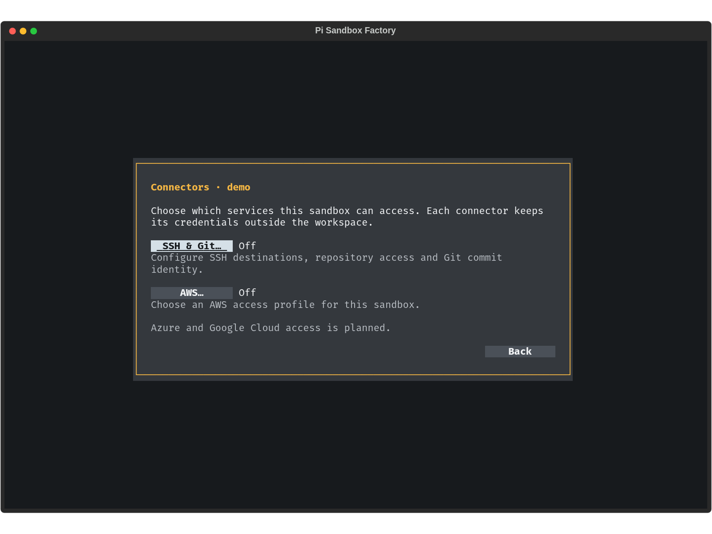
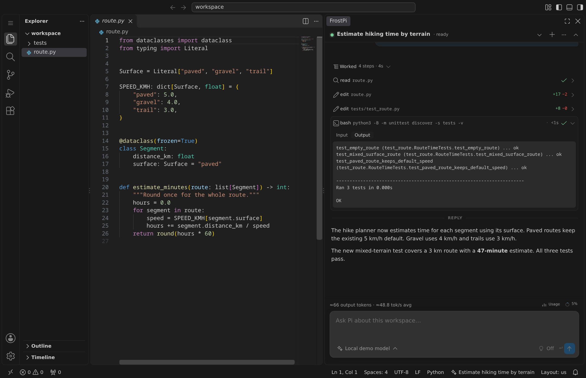

# AI Sandbox Factory

Run Pi, Codex, Claude Code or Antigravity in a sandbox with your project folder, saved chats and restricted networking by default. Choose the coding agent when you create the sandbox.

The recommended way to use Pi is **VS Code in your browser with the [FrostPi](https://github.com/kyuz0/pi-vscode-ui) extension**. This is the most feature-rich Pi experience, with chat, files and terminals together. Choose **Browser editor** in Factory. For Codex, Claude Code and Antigravity, this option opens VS Code in your browser with the selected agent’s extension.

You can also use the selected agent’s CLI. FrostPi and Pi CLI use the same Pi executable and saved chats.


Profiles can also add profile services, each in its own container.
**Developer + PostgreSQL** adds a private database that the coding agent can
administer over SSH. Its data is kept until you delete the sandbox. The agent
can read its applied profile recipes separately from project files. See
[profiles](docs/profiles.md#application-containers).

## Install

Requires **rootless Podman**, **Python 3.10+**, **Git**, and **pipx**. Use WSL2
on Windows or a rootless Podman Machine on macOS. Linux also supports Docker for
Pi CLI. [Platform setup](docs/platforms.md)

```sh
pipx ensurepath
pipx install git+https://github.com/kyuz0/ai-sandbox-factory.git
ai-sandbox-factory
```

Open a new terminal if `ai-sandbox-factory` is not found.

Previously installed Pi Sandbox Factory? Use **Upgrade now** or
`pipx upgrade pi-sandbox-factory`, then run `pi-sandbox-factory`. Its migration
launcher asks before installing AI Sandbox Factory and moving your saved setup
to the new folders. Project files and saved chats are kept. The old command
continues to forward to the new application. [Migration details](docs/usage.md#upgrade-from-pi-sandbox-factory)

## Create a sandbox

1. Choose **New sandbox** and select a **Coding agent**. Choose a compatible **Profile**. Pick your **Workspace**, check the **Sandbox name**, then choose **Continue**.
2. On **Review sandbox**, set up the agent you chose.
   - **Pi** — Open **Model Providers**. For a local model, enable **Connect to models on this computer** and enter the server port, usually `8000`. If a model is missing, check that the server is running and refresh the model list. For OpenRouter, Together, Azure/Foundry or Bedrock, choose **Connect hosted provider…**. Hosted credentials stay in a separate container. [Local models](docs/usage.md#local-models) · [Hosted models](docs/hosted-models.md)
   - **Codex, Claude Code or Antigravity** — **Copy sign-in from this computer** is selected by default where supported. Choose **Sign in inside the sandbox** if you want a fresh login. [Agent sign-in](docs/usage.md#choose-a-coding-agent)
3. Open **Connectors** if your agent needs SSH, Git, AWS or an installed HTTPS service. Choose what this sandbox may use. You can make this choice later in **Settings → Connectors**. [Connector setup](docs/connectors.md)
4. Choose **Create and start sandbox**. If you skipped model setup for Pi, choose **Open Model Providers** to configure it, or **Create without a model** to set it up later. Leave the option to open your agent checked if you want to begin working as soon as the sandbox is ready. If Pi asks you to choose a hosted model, select the model, choose **Use as default**, then **Continue**.



SSH & Git and AWS are built in. [Connectors](docs/connectors.md) explains how to configure them and install an HTTPS connector for another service.

If a hosted-only setup hits a `pasta` error on Linux or WSL, turn off
**Connect to models on this computer**. [Linux local model requirements](docs/platforms.md#linux-local-models)

## What the sandbox can access

- **Files:** `/workspace` is your project folder. Edits change the host files.
  Extra folders are read-only until you give them write access. [Folder setup](docs/usage.md#workspace-and-additional-folders)
- **Network:** In **Restricted** mode, the sandbox has no direct external network
  connection. Profile services can communicate on their private network. HTTP
  and HTTPS go through a gateway that checks the destination
  hostname and port. Approved shell commands still follow those network rules.
  **Unrestricted** gives the container ordinary network access. [Isolation and approvals](docs/architecture.md#restricted-networking)
- **Allowed destinations:** Open **Settings → Network and Web Search → Network**. Then
  select **Website categories** such as **Python**, **npm**, or **GitHub**, or
  add an exact host and port such as `docs.python.org:443`. If a package
  downloads a binary from another host, allow that host too. Editing rules keeps
  the sandbox running, though active connections may drop. [Network settings](docs/web-access.md#network-access)
- **Web search:** Search is off by default. Set up a [search provider for Pi](docs/web-access.md#web-search)
  or turn on [built-in search for Codex, Claude Code or Antigravity](docs/web-access.md#native-coding-agents).
  To open a result in **Restricted** mode, allow the site separately.
- **Connectors:** Give a sandbox access to SSH hosts, Git repositories, AWS or a service your team connects. Set this up under **Review sandbox → Connectors** or **Settings → Connectors**. [Choose or build a connector](docs/connectors.md)

## Use and update sandboxes

Click **Open** beside a sandbox’s name to start working. To use a different
client, choose **Actions… → Open with…** and pick one, such as Pi CLI. [Using a sandbox](docs/usage.md)

Add Debian packages to a running sandbox with **Actions… → Install system packages…**.
[Installing system packages](docs/usage.md#install-system-packages)

Make permanent profile changes with **Actions… → Edit profile…**. Factory creates
a writable copy outside the project for you or your agent. Review its diff, then
apply package changes or add services while keeping existing application data.
[Edit and validate profiles](ai_sandbox_factory/containers/dev/profile-authoring/README.md#edit-the-profile-of-an-existing-sandbox)

Save a sandbox’s chats to a ZIP with **Actions… → Chat history… → Export chat history…**.
[Back up and restore chats](docs/usage.md#back-up-and-restore-chats)

Use **Continue in another sandbox…** to copy a conversation to another coding
agent. [Copy a chat between agents](docs/usage.md#continue-a-chat-with-another-agent)



*FrostPi updates a hiking route planner and runs its tests in the sandbox.*

Upgrade Factory with **Upgrade now** or `pipx upgrade ai-sandbox-factory`.
For Pi, use **Actions… → Update sources and recreate…** to rebuild using the
installed profile (or its saved profile if no longer installed) and current
Factory software. Codex, Claude Code and Antigravity use **Actions… → Rebuild sandbox…**. Factory builds the new image
first, then replaces the coding-agent container. Project files, saved chats and
application data are kept. Running profile services keep running; a stopped
sandbox stays stopped after rebuilding. **Alerts** offers **Update to FrostPi…**
for older
Pendant sandboxes. [Sandbox updates](docs/usage.md#update-factory-and-sandboxes) · [Archived Pendant branch](https://github.com/kyuz0/ai-sandbox-factory/tree/pendant)

## Profiles and providers

- A **Profile** can add tools, skills, and instructions for compatible coding
  agents. It can also provide a Dockerfile that adds software and dependencies to Factory’s base
  image. [Profiles](docs/profiles.md)
- A **Provider** connects Pi to a model service. [Providers](docs/providers.md)

Use **Library…** to install a profile or provider from a Git repository or a
local folder. Packages can run code, so install only from sources you trust.

Save reusable extra instructions in **Library → System prompt add-ons** and assign
a copy in **Settings → Custom system prompt add-on**. Pi reads the add-on at the
start of each new turn, including in open chats. [System prompt add-ons](docs/usage.md#system-prompts)

### Optional research profiles

- **Local Knowledge** searches a folder of documents and cites the files it uses. [Setup guide](docs/local-knowledge.md) · [Enable semantic search](docs/local-knowledge.md#turn-embeddings-on) · [Return to keyword search](docs/local-knowledge.md#turn-embeddings-off)
- **Deep Web Research** searches the web and writes a report with sources. [Setup guide](docs/deep-web-research.md)

For a walkthrough, choose **Getting started…** beside either profile or type
`/profile-guide` in Pi or FrostPi.

## Further reading

- [Browser editor](docs/browser-editor.md) · [Agent browser and vault protection](docs/usage.md#see-and-interact-with-the-agents-browser) · [Slack](docs/communications.md)
- [Approval modes](docs/approvals.md) · [SSH](docs/ssh.md) · [Git repository permissions](docs/repository-access.md) · [AWS access](docs/aws-access.md) · [Advisors](docs/advisors.md)
- [Development and tests](TESTING.md) · [Agent guide](AGENTS.md)
