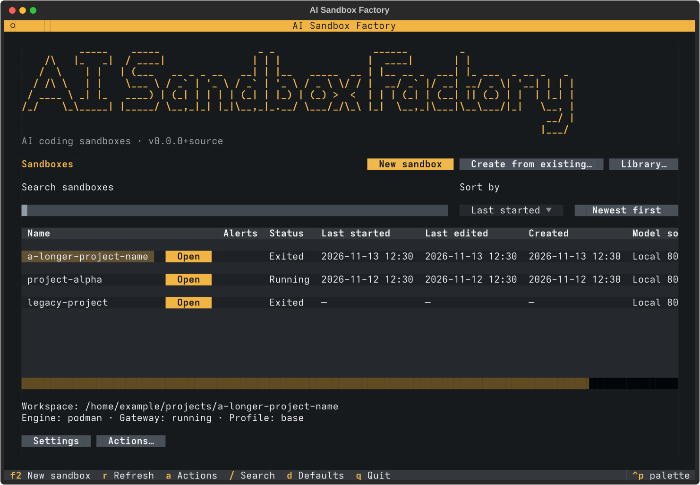

# Pi Sandbox Factory

Pi Sandbox Factory runs Pi coding agents in development containers so you can
control which files, commands and network destinations they can access. Select a
project folder, choose your models and create a sandbox from the terminal UI.
Network access is restricted by default; commands needing broader permissions
go through approval and still run inside the container.

The default editor runs in your browser with [Factory’s FrostPi fork](https://github.com/kyuz0/pi-vscode-ui/tree/pi-sandbox-factory).
We switched from Pendant because FrostPi is open source and we can adapt it to
Factory. It runs the same mainline `pi` executable as Pi CLI, so the editor
and terminal stay in sync on Pi versions, models and extensions.
You can also use Pi CLI or host VS Code. Each sandbox keeps its own tools, model
settings and conversations.



## Install

You need Python 3.10+, Git, pipx and rootless Podman. On Windows, run inside WSL2;
on macOS, use Podman Machine. See [platform setup](docs/platforms.md).
Linux also supports Docker with Pi CLI or host VS Code. Host VS Code needs `code`
on your PATH; the launcher installs Dev Containers if needed.

```sh
pipx ensurepath
pipx install git+https://github.com/kyuz0/pi-sandbox-factory.git
pi-sandbox-factory
```

Open a new terminal if the command is not found. The first build downloads Pi,
FrostPi and their dependencies.

## Create a sandbox

Choose **New sandbox**, select your project folder and configure a model:

- **Local server:** open **Model Providers**, enable local models and enter its port, usually `8000`. The included
  [Pi Local Model Manager](docs/usage.md#local-models) discovers the running model.
- **OpenRouter, Together, Azure/Foundry or AWS Bedrock:** open **Model Providers → Built-in hosted providers → Connect hosted provider…**. Factory keeps credentials outside Pi and
  editor extensions; see [hosted model setup](docs/hosted-models.md).

Choose **Create and start** to open the editor. To reopen a sandbox, select its row
and choose **Open** next to its name. Use **Settings** to change the
configuration and **Open with…** to choose a different client, such as Pi CLI.
See [everyday use](docs/usage.md) for additional folders, skills and CLI commands.

Factory reports missing host dependencies on startup. After a creation failure,
choose **Retry creation** to reuse the current configuration or **Back to
configuration** to edit it. If cleanup fails, use **Actions… → Delete sandbox…**
from the sandbox list to finish removing the failed attempt.

During creation, **Cancel creation** stops the operation and removes that sandbox's
runtime containers, private volumes and saved settings. Failure cleanup and
cancellation both preserve your project files and reusable build cache.

The manager offers **Upgrade now** when a new version is available. You can also
run `pipx upgrade pi-sandbox-factory`. Update existing sandbox images through
**Actions → Update sources and recreate…**.
Use **Cancel update** while Factory prepares the replacement to keep your current
sandbox running. Once Factory starts applying changes, it finishes the update
before returning you to the sandbox list.

When enabling **Browser · Betterwright**, **Protect saved browser vault files**
is on by default. It blocks direct file-tool access to `~/.betterwright/vault`;
browser account selection and login still work. Inner Bash hides private home,
and reviewed shell commands remain subject to credential policy. An authorized
service login can be handed privately to a local script without exposing the
saved vault. Human logins are not saved automatically.

This is an agent-tool guard, not isolation from malicious editor or Pi extensions
running with the same user permissions. They may access container files or active
browser sessions; see [VS Code's extension runtime security](https://code.visualstudio.com/docs/configure/extensions/extension-runtime-security).
Disabling the option removes only the extra vault file guard;
other sandbox and approval rules still apply.
With the inner sandbox and approval reviews both off, Bash can read vault files;
the checkbox continues to protect native file tools only.

### Switch an existing Pendant sandbox to FrostPi

Open existing Pendant sandboxes as usual until you're ready to switch. Update
Factory, select the sandbox, then choose **Actions → Update sources and recreate…**.
Factory builds the replacement first, then restarts the sandbox. Your workspace
and saved Pi chats are kept. Reopen the editor and resume a chat.
Choose **Show Alerts** on a sandbox row to find the update for a sandbox saved with Pendant.
The previous Factory release is preserved on the [Pendant branch](https://github.com/kyuz0/pi-sandbox-factory/tree/pendant).

## Profiles and providers

A **Profile** supplies tools, skills and agent instructions. A **Provider** connects
Pi to a model service and configures its models. Install either through **Library…**
from a Git repository or local folder, then select it in the sandbox configuration.
Packages contain executable code; install ones you trust.

```sh
pi-sandbox-factory profile add reporting /path/to/reporting-profile
pi-sandbox-factory provider add company git@git.example.com:team/plugins.git --subdir models
```

Save reusable instructions in **Library → System prompts**. Choose a prompt
when creating a sandbox or in **Settings → System prompt**. Each sandbox keeps
an editable copy. Changes apply when Pi starts its next reply, including in
open chats. If the setting shows an update notice, choose
**Actions → Update sources and recreate…** once.

- [Create a profile](docs/profiles.md) or [provider](docs/providers.md).
- [Browser editor](docs/browser-editor.md), [web search](docs/web-access.md) and [Slack](docs/communications.md).
- [Isolation and architecture](docs/architecture.md), [approvals](docs/approvals.md), [SSH](docs/ssh.md), [repository permissions](docs/repository-access.md) and [advisors](docs/advisors.md).
- [Development and tests](TESTING.md), [agent guide](AGENTS.md).
