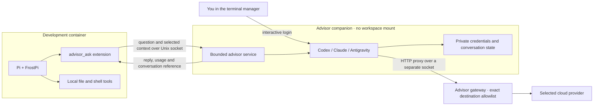

# Advisors

Pi can ask Codex (OpenAI), Claude (Anthropic) or Antigravity (Google) for a second opinion. It sends the question and selected context, receives the reply unchanged, and carries out any suggested work using its own tools and permissions.

## Setup

1. Open **Advisors (Codex/Claude/Antigravity)** in **Review sandbox** or in **Settings**.
   **Apply** builds the companion and restarts the development container, preserving
   its workspace and private home.
2. Select **Copy credentials from host** before applying, or return to the advisor
   settings afterward and choose **Sign in**. Login becomes available
   once the advisor is installed. Follow the CLI's browser or device-code instructions.
3. Use **Check advisors** to check login status and available models or quota.
4. Reopen Pi or FrostPi and run `/advisor status` to see which advisors are ready.
   Then ask Pi to consult one, for example “Ask Claude to review this plan.”
   For a follow-up, ask Pi to continue the same consultation. Pi can return to the
   advisor’s conversation using its saved reference. Run `/advisor usage` to see
   usage or `/advisor cancel` to stop a request.

Set an optional per-session call limit under **Usage and network**.

The CLI can add providers during creation with `--advisor codex`, `--advisor claude` and/or `--advisor agy`. Sign in afterwards:

```sh
ai-sandbox-factory advisor-login NAME codex
ai-sandbox-factory advisor-login NAME claude
ai-sandbox-factory advisor-login NAME agy
ai-sandbox-factory advisor-check NAME
```

Codex's [device login](https://developers.openai.com/codex/auth/) must be enabled for your account. Antigravity uses its documented [remote login flow and Linux Secret Service](https://antigravity.google/docs/install?tab=cli). The companion has its own keyring; it never mounts your desktop session bus.

## Copy a host sign-in

**Copy credentials from host** is a one-time choice for each advisor. It replaces
that advisor’s saved login with the host login. The CLI equivalent is:

```sh
ai-sandbox-factory advisor-import NAME codex
ai-sandbox-factory advisor-import NAME claude
ai-sandbox-factory advisor-import NAME agy
```

Codex imports the ChatGPT sign-in from `$CODEX_HOME/auth.json` (default
`~/.codex/auth.json`). Claude imports its [subscription login](https://code.claude.com/docs/en/authentication) from
`$CLAUDE_CONFIG_DIR/.credentials.json` (default `~/.claude/.credentials.json`).
Antigravity copies its Linux Secret Service entry; the host needs `secret-tool`
and an unlocked keyring. Install `libsecret` on Fedora or `libsecret-tools` on Ubuntu
if that command is missing.

On macOS, file-based Codex and Claude logins can be copied through the same paths.
Claude normally stores its login in Keychain; importing that entry is not supported.
Antigravity's macOS Keychain entry and keyring-only Codex logins also require a
separate login through the **Sign in** button in advisor settings. Use **Check advisors**
after signing in.

Only credentials are copied; CLI settings, hooks and conversations are excluded.
The copy stays in the advisor’s private volume and is not synchronized with the host.
If it expires or is invalidated, use **Sign in** in advisor settings for that
provider, then **Check advisors** and ask Pi to retry.

## Choosing an advisor

Each `advisor_ask` call selects one enabled provider. Pi’s tool instructions tell
it to check `advisor_status` for enabled providers, models and available quota,
then choose a provider explicitly when useful. You can ask “Use Claude to review
this change” or “Get separate opinions from Codex and Claude.”

Without an explicit `provider`, Pi uses the first enabled advisor in this order:
Codex, Claude, Antigravity. Follow-ups keep the original provider and model;
switching starts a new consultation with the context Pi supplies.

## Images

Ask Pi, for example: “Send `screenshots/settings.png` to Claude and review the layout.”
All three advisors accept PNG, JPEG and WebP files: up to four images per request,
5 MiB each and 10 MiB total. Pi can attach new images during follow-up conversations.
Images in the chat are not automatically sent to an advisor.

## Where things run



The companion has no direct network. Its gateway has a separate allowlist: enabling advisors does not widen the development container's network policy. Provider hosts are supplied as defaults; add exact hosts and ports under **Usage and network** if your account's login route requires others.

Provider tools are disabled; Pi carries out suggested work through its own tools and approval rules.

`advisor_ask` has a separate permission rule. Access to the socket permits consultations and consumes provider quota. The service accepts questions and selected context; it rejects arbitrary commands and configuration changes.

Login state survives stopping and rebuilding. Deleting the sandbox removes it. The host account that owns the containers retains access to their storage.

## Models and quota

Open **How Pi chooses an advisor model** during sandbox setup or in **Settings → Advisors (Codex/Claude/Antigravity)**. In Pi or FrostPi, enter `/advisor status` to see available models, provider descriptions, remaining quota and reset times.

Pi follows your chat preference first, then the model preference in your sandbox settings. For Codex and Claude, Pi compares the default with the other models the provider describes. When two versions of the same family suit the task equally well, Pi prefers the newer one. If there’s no clear match, Pi uses the default. Antigravity uses its default unless you choose another model.

To save a preference for the current chat, enter a command like this:

```text
/advisor preference Use Sol for routine Codex questions. Use Astra for hard questions when more than 50% of quota remains.
```

Enter `/advisor preference` to see your preference or `/advisor preference clear` to remove it. You can also ask Pi to show you the choices before it consults an advisor. A percentage rule requires a known quota. The sandbox’s spending limits still apply. The clients report subscription usage in quota windows and do not give a price per consultation.

Under **Claude model** you can set a preferred model and effort. Under **Antigravity model** you can restrict that advisor to one model and specify its quota group if needed.

To update the installed advisor, use **Actions → Update sources and recreate…**, then reopen Pi or FrostPi.
