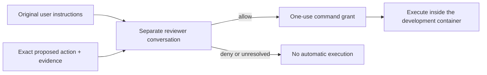

# Approvals

Both automatic modes use the current chat model by default to review actions that
need approval. The reviewer has its own conversation, separate from the agent doing
the work. It receives the exact action, original user instructions from the
active Pi branch and relevant tool evidence already available to Pi.

The reviewer makes one model request per approval and has no tools. It judges the
proposed action against the user’s instructions; earlier approvals do not authorize
different actions.

You can authorize an interactive browser login followed by private local session
reuse in a CLI for the same service. Session values must stay out of model output,
logs, Git and other destinations; local session files need mode 0600 in a private
directory. Existing browser-tool and inner-sandbox restrictions still apply.
Advisor consultations can discuss this workflow; the actual helper or command is
reviewed separately before execution.

Enabling browser support allows native `browser` calls without per-action review.
The outer network allowlist still applies, and downloads keep their separate approval.

Built-in goal creation, updates, task tracking and goal questions need no approval.
Actions performed to achieve a goal keep their normal permissions. Goals have no
token budget unless you request one; zero is a literal zero-token limit. To remove
an existing budget, the agent can use `update_goal` with `token_budget: null`.

## Choosing a shell

| Task | Tool |
| --- | --- |
| Read installed skill instructions and references | `read`, `grep`, `find`, `ls`, or a read-only Bash command |
| Edit workspace files or run ordinary commands | `bash` inside the inner sandbox |
| Create files for this command only | `bash`, using `$TMPDIR` |
| Keep files for later commands | Use a workspace directory such as `.tmp/` |
| Browser automation with Betterwright enabled | Native `browser` tool |
| Python Playwright or `sandbox-browser` in the spikee profile | `bash_escalate` when the inner sandbox is enabled; otherwise `bash` |
| Create, inspect or stop a tmux session | `bash_escalate`, using the same explicit `tmux -S` socket path each time |
| Reach an outer-container service on loopback | `bash_escalate` when the inner network namespace cannot reach it |

The inner sandbox blocks Unix sockets, so changing tmux's socket directory does
not make it work there. Escalated commands still require review and run inside
the development container. The outer network allowlist and protected credentials
remain enforced. Installed-file read access does not grant write access.

By default, Pi and shell commands cannot read common credential files such as
`.env`, private keys and certificates. For a disposable environment whose
credentials may be shown to the model, clear **Protect common credential files**
under **Settings → Approvals & sandbox**. This changes reads
and writes: the agent can see and change those files like other workspace files.

## Conversation and limits

Original user messages are read from Pi's active branch, including originals
before compaction. A generated summary is not treated as user authorization.
New messages and actions are appended to the reviewer conversation. The
controller ignores appended compaction summaries and display metadata. New original
instructions or edits still invalidate an in-flight decision. Parallel reviews use separate copies; branch, model and configuration
changes invalidate reuse.

Original user text and nearby assistant context share an estimated 32,768-token
reviewer input budget. Screenshot messages retain their text; images are marked
as uninspected rather than sent to the text-only reviewer. Missing visual facts
can require deferral when they matter to the action. Omissions are reported.
When history fills, it is rebuilt from original instructions; if those cannot
be reconstructed intact, automatic approval is withheld. Reviewer history is
held in memory and resets on Pi restart.

A review can produce up to 32,768 output tokens and has a ten-minute maximum
deadline. Invalid replies, unexpected tool calls,
timeouts and provider failures do not grant permission. Default failure handling
returns the reason to the agent without opening a dialog. The agent can retry a failed
review or choose an allowed alternative. Thinking defaults to Low. If the model
does not offer Low, the reviewer uses its lowest enabled level. Thinking tokens share
the output allowance.

## Configuration and updates

For an existing sandbox, select it in the Factory manager, open
**Settings → Approvals & sandbox**. Choose **Approval mode**, change
**Use inner command sandbox** or **Protect common credential files**, then select **Apply and recreate**.
This stops running processes, including tmux sessions, but preserves files and
saved chats. Reopen Pi or Pendant to resume the conversation with the new settings.

- **Automatic (non-interactive)** is the default. The reviewer handles requests
  without asking you. If it blocks an action, the agent gets the reason and can
  try another permitted approach.
- **Automatic (interactive)** asks you when the reviewer leaves a decision open
  or a tool requires confirmation. Explicit denials and reviewer failures block
  the action.
- **Manual (ask me)** asks you to decide on requests that need approval.
- **No approval prompts (YOLO)** turns off approval prompts. Commands stay inside
  the inner sandbox when it is enabled. The outer container and its network
  rules apply in every mode.

Pi and Pendant show the approval mode when you open a chat. In either automatic
mode, use `/auto-review-settings` to change the reviewer model or thinking effort
for that chat. Choose **Current chat model** to follow the model selected in Pi or
Pendant. Choose **Off** under **Thinking effort** to send a review without
requesting thinking. New chats and resource reloads restore the saved defaults.

In Pi's interactive terminal, `/auto-review-approve` requests one retry of an
exact denied action.

In both automatic modes, `/opt/pi-security/config/auto-review.json` selects the
current chat model and enables `retainedContext` and `reviewerConversation`. Inspection tools cannot be
enabled. Project files cannot disable this context handling or choose another
reviewer. Configure trusted settings through the image, not through agent-edited
workspace files.

For extension updates, see [Extensions](extensions.md). The outer container,
network and credential boundaries are described in [Architecture](architecture.md).
