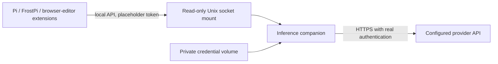
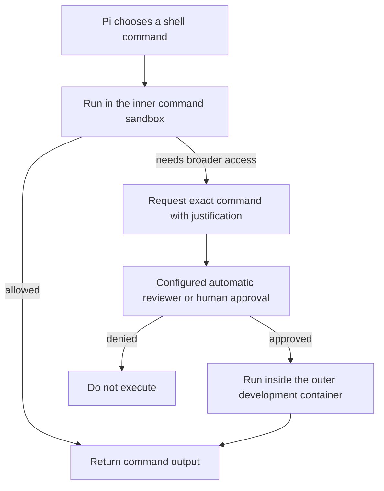

# Architecture and permissions

## Files and processes

The Factory terminal app runs on your computer and manages rootless Podman
containers. The browser editor runs Pi, FrostPi, and the editor server inside the
development container. If you choose desktop VS Code, the app runs on your
computer and connects to the sandbox through Dev Containers.

The folder you choose on your computer appears as `/workspace`. When Pi edits a
file there, it changes the original file on your computer.

Desktop VS Code and its extensions remain trusted host software. A remote extension
can use VS Code APIs that request client-side resources; Dev Containers alone is
not isolation from malicious editor extensions. The default [browser editor](browser-editor.md)
runs the backend in the container and uses the browser filesystem permission boundary
for client-side access.

Each sandbox has a separate persistent home volume for Pi configuration and sessions. Desktop editor state is kept separately on the host. Stopping or recreating containers preserves that saved state. Deleting a sandbox removes its private home and editor state, but keeps the selected workspace and shared images.

Factory imposes no process/thread caps or default container memory quotas. The
editor, browser, development tools and companions share the host's available
capacity. An explicit sandbox memory setting limits the development container.
Relay failures retry their fixed routes without stopping active editor work.
The editor supervisor continuously collects exited helper processes.

## Restricted networking

In **Restricted** mode, programs inside the development container have no
direct network connection. They send HTTP and HTTPS requests through the proxy
Factory puts in their environment. The proxy relays those requests to a separate
gateway container, where Squid checks the destination hostname and port.

The development container runs with `--network=none`. It reaches the gateway
through a Unix socket in a shared volume that it mounts read-only.

For host-local models, the rootless Podman gateway uses pasta's host-loopback mapping. `local-model.internal:8000` reaches the host model server at port 8000. The discovery extension reads that server’s metadata and updates Pi’s model catalogue.

Updating allowed destinations restarts only the gateway. Retry interrupted requests.
Changing the network mode or host model ports recreates the sandbox and stops its
processes. **Unrestricted** mode gives the development container ordinary bridge
networking. [Network settings](web-access.md#network-access)

## Inference credentials

The host manager imports keys directly into the companion. Its fixed HTTPS routes
allow inference and required catalogue requests; it replaces client authentication,
signs Bedrock requests and streams responses without changing their protocol.
It exposes no TCP listener or credential-management HTTP API. Credentials are bound
to the configured upstream origin. Changing that origin requires credential entry.

The development container has no mount for the credential volume or container
engine socket. Compromised agent or editor code can still make allowed inference
requests and spend quota. Provider-side budgets and permissions limit that use.
The host manager, container runtime and configured upstream service remain trusted.

Inference streams have no concurrency cap, idle cutoff or total-duration deadline.
Client cancellation closes the upstream request; TCP keepalive detects dead peers.
Each upload may contain up to 32 MiB; the companion buffers up to 64 MiB of concurrent uploads, releasing each
body after forwarding it. Additional uploads wait for buffer space; cancellation
releases their reservations.

## Commands, approval and skills

By default, the current Pi model reviews commands that exceed the inner sandbox’s
permissions. [Approval modes](approvals.md) also support human review or refusing
elevation. An approved command keeps the development container’s user, mounts
and network rules.

The inner sandbox restricts shell commands. Pi and its extensions run outside it,
inside the development container. Disabling it leaves the outer container and
network restrictions in place.

Skills supply task instructions. Extensions add capabilities such as model discovery, questions and scheduled prompts. The shared Pi goal extension is available in both clients. Browser support and subagents are optional. Scheduled prompts run only while their originating Pi session is open.

## Packages

The host registry stores exported Git revisions. Each sandbox copies its selected
profile and providers into its own immutable build inputs. Installing or updating
a registry entry does not change a running sandbox. Rebuilding applies updates
only after the new image builds successfully.

A profile adds tools and Pi resources. A provider adds a small adapter run inside
the development container, plus optional Pi extensions and skills. Both Pi and
FrostPi use the private home catalogue. A shared lock serializes model updates;
credentials enter through stdin and are never included in image layers.

## Browser access

Browser support uses one headful Chromium and private TigerVNC display per Pi
session inside the development container. noVNC shows the same native browser
window controlled by the agent, including tabs and popup windows. X11 TCP and
RFB TCP listeners are disabled; display access uses a private authority cookie
and the RFB and WebSocket bridge use owner-only Unix sockets.

A host Python process relays authenticated viewer requests through a fixed
container helper; it has no arbitrary destination or command interface. The
helper validates the owned private profile, live Chromium endpoint and socket.
The host caches the bundled noVNC client once, and Node's maintained `ws` transport
bridges its connection to the private display. Clipboard transfers require user
action and native password saving is disabled. Older immutable images retain
their existing DevTools viewer until updated.

Each viewer uses its own loopback address. Host cookies and authorization headers
are never forwarded.
Opening the sandbox repairs a stopped viewer; stopping the container ends it.
The viewer key rotates on restart. Session links are capabilities, visible in
chat history. Sessions share the container Unix user, so their identifiers prevent
accidental mix-ups rather than providing isolation against malicious container code.
The viewer trusts the client and DevTools frontend supplied by the installed browser image.
