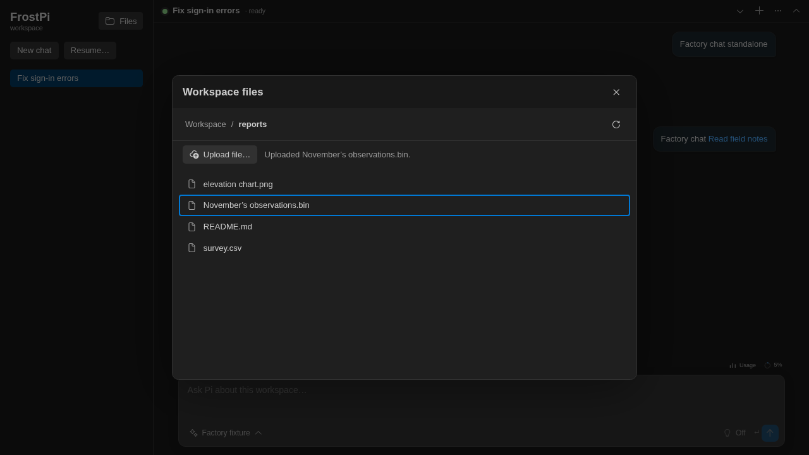
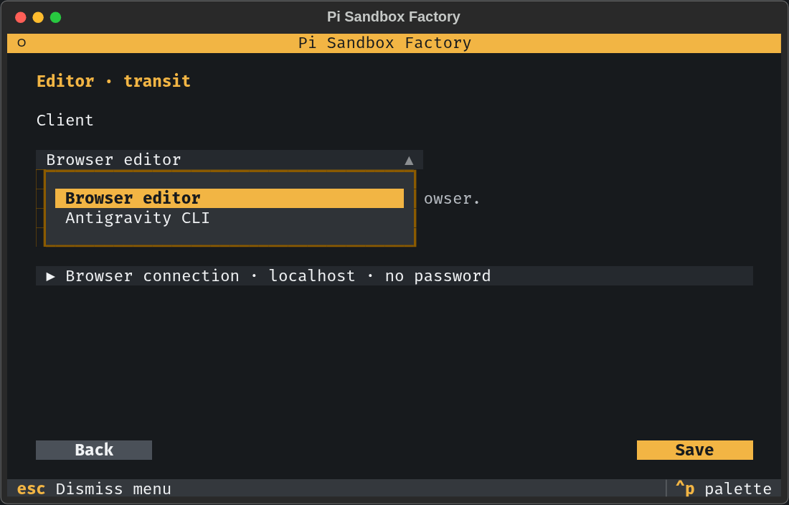

# Browser editor

The browser editor is the default with rootless Podman on Linux, Windows
through WSL2, and macOS through Podman Machine. Pi opens FrostPi; Codex, Claude Code and Antigravity
open their own VS Code chat panels. The editor and its extensions run inside the
workspace container. Choose **Open with…** to use the selected agent's CLI instead.
Pi also supports VS Code on your computer. The browser editor supports amd64 and arm64
containers. [Platform setup](platforms.md)

FrostPi previews images Pi receives from tools such as `read` and Betterwright.
Click an image to enlarge it. You can see it again when you reopen the saved chat.

## Open a sandbox

Leave **Open the browser editor when ready** checked to open the selected agent's editor when the sandbox
starts. The first launch downloads the pinned version of code-server for the
container’s architecture. Codex, Claude Code and Antigravity also download their pinned VS Code extension.
[Create a sandbox](../README.md#create-a-sandbox)

The selected workspace opens trusted, in dark mode, with the selected agent's chat
on the right. The built-in VS Code chat is hidden. FrostPi's first chat shows the
approval mode; select your model and start a conversation.
Files in `/workspace` are your project files; additional mounts appear under `/mnt`.

Codex, Claude Code and Antigravity use the sandbox's existing sign-in. Their signed-in process
runs in a separate container; the browser editor does not receive its credentials.
For a fresh login, complete the terminal sign-in before the editor opens. Use
**Settings → Sign-in** to sign in again or copy a host login.

Antigravity supports text messages in its browser panel. Ask it to work with files
in the workspace; attaching files to a chat message is not supported. Use Explorer
to upload files when **Allow file uploads** is enabled.

In Codex, **Stop** ends the current reply. A command it started may keep running.
Ask Codex to stop that command if you also want to end it.

Closing the tab or manager leaves the editor running. Choose **Open** beside the
sandbox to return to it. **Actions… → Stop browser editor** stops the editor and its terminals,
active FrostPi runs and scheduled prompts. Pi CLI sessions remain independent.
Stopping the sandbox stops both clients.

## Open FrostPi on its own

Choose **Open with… → FrostPi in browser** for chat on this computer. Choose **Settings → Editor → FrostPi in browser** to use it whenever you open the sandbox. This client is included in new Pi sandbox images.

Choose **New session** to start a conversation or **Resume session** to open a saved Pi chat. Refreshing the page keeps the current conversation. Closing the tab leaves Pi running. The browser address contains a private link to this sandbox.

Choose **Files** to browse the workspace, or click a file path in a reply to open it directly. You can read text and Markdown and view images. Select a folder name above the preview to go back. Press **Escape** to return to your chat and draft.

Markdown can display images stored in the workspace. Images hosted on other websites show the site name and stay blocked. Opening a website link asks for confirmation and shows its address.

To transfer files, open **Settings → Editor → FrostPi in browser**. Turn on **Allow file uploads** or **Allow file downloads**, save your settings and reopen the editor. Both options are off by default.

In **Files**, open the destination folder and choose **Upload file…**. If a file with the same name already exists, the original stays in place. To save a file to your computer, open it and choose **Download**. You can download files even when a preview is unavailable. Turning off downloads still lets you read previews in your browser.



## Upload files in VS Code

Under **Editor**, select **Browser editor** and check **Allow file uploads**. For an existing sandbox, open **Settings → Editor**, save the change and reopen the editor. Uploads are off by default.

Drag files from your computer onto a writable folder in Explorer, or right-click the folder and choose **Upload…**. Files placed in `/workspace` also appear in the project folder on your host.



## Connection settings

During creation, expand **Editor → Browser connection**. For a saved sandbox,
use **Settings → Editor → Browser connection**.

- **Listen address:** empty chooses a separate local-only address for each sandbox.
  Enter a specific IP address and enable a password to use a custom address.
- **Port:** empty chooses an available port and remembers it. Enter a port to fix it.
- **Require a password:** off by default. Enter a password or choose **Generate**;
  **Show password** lets you copy it. Only its hash is saved.

Changing settings stops a running editor. Use **Open** to launch it again.
Creating from another sandbox copies the editor choice and file transfer settings. Connection addresses and
passwords start fresh.

To connect from another computer, enter the host's interface IP, enable a password
and supply an HTTPS certificate and private key. These fields appear when the
address is non-local. The certificate must be trusted by the connecting browser
and cover that IP. FrostPi's webviews require a secure browser context. The key
stays on the host and must have permissions `0600`; encrypted keys are unsupported.

## Choose a client

**Settings → Editor** changes the default client. **Open with…** selects a client
for one launch. Use Pi CLI alongside either editor.

For **VS Code on host**, put `code` on your PATH. Factory installs the Dev
Containers extension if needed.

A sandbox used with the VS Code browser editor cannot subsequently attach to host VS Code: that
would give its installed extensions a bridge back to the host client. Create a
separate sandbox for host VS Code. A running desktop VS Code server also prevents
browser-editor startup.

## Command line

```sh
pi-sandbox-factory open NAME
pi-sandbox-factory open NAME --editor pi
pi-sandbox-factory open NAME --editor frostpi
pi-sandbox-factory open NAME --editor desktop
pi-sandbox-factory browser-editor NAME --background
pi-sandbox-factory browser-editor NAME --stop
```

`open` uses the saved client. The `browser-editor` command without `--background`
runs in the foreground; Ctrl+C stops it. `--no-open` prints the address without
opening a tab.

## Access boundaries

The editor backend, FrostPi and its tools can access the selected workspace,
additional mounts and container home. Container mounts enforce read-only folders.
Do not mount a directory containing secrets that extensions should not read.

Browser extensions run in the browser's web worker environment. They have no
unrestricted host filesystem or local terminal. Explicit browser file grants,
clipboard permissions and uploads can expose data; use a separate browser profile
and grant only what you intend to share. The launcher checks Host and Origin on
HTTP and WebSocket requests. Local access is passwordless by default; enable a password on a shared computer. With a password
enabled, code-server authenticates both HTTP and WebSocket sessions.

The container network policy controls backend traffic, including extension package
downloads. Gallery searches and other browser-side requests can use the host
browser’s network. Seeing an extension in search does not mean its package can
be downloaded inside the sandbox.

[FrostPi checks](../TESTING.md#frostpi-editor-and-shared-pi-goals) cover first
launch, reviewer prompts and handoff to Pi CLI. [Browser editor checks](../TESTING.md#browser-editor)
cover login protection, untrusted extensions and session cleanup.

## References

- [VS Code execution location and client resources](https://code.visualstudio.com/api/advanced-topics/remote-extensions#execution-location-and-access-to-client-resources)
- [code-server architecture and differences](https://coder.com/docs/code-server/FAQ)
- [Browser filesystem access](https://developer.mozilla.org/en-US/docs/Web/API/File_System_API)

## File updates

Explorer normally updates through native filesystem notifications. If an editor
file or folder watcher cannot start because a Linux watch limit is exhausted,
Factory polls that path every two seconds instead. This does not change host
kernel settings. Recursive watchers used by other extensions can still require
available native watches. Stopping unused sandboxes frees their watcher resources.
