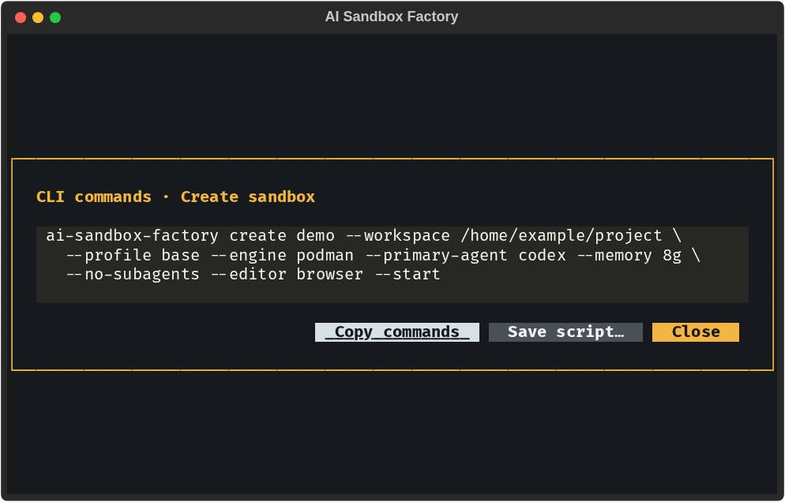

# Command-line use

Use the CLI to create, configure and manage sandboxes without opening the TUI.
Run `ai-sandbox-factory COMMAND --help` for every option of a command.

- [Create and open](#create-and-open)
- [Get commands from the TUI](#get-commands-from-the-tui)
- [Creation files and credentials](#creation-files-and-credentials)
- [Inspect and change settings](#inspect-and-change-settings)
- [Models and keys](#models-and-keys)
- [Copies and profiles](#copies-and-profiles)
- [Chats](#chats)
- [Libraries and defaults](#libraries-and-defaults)
- [Scripts and cancellation](#scripts-and-cancellation)
- [TUI actions and commands](#tui-actions-and-commands)

## Create and open

Create a Pi sandbox for the current directory, then open it in the browser editor:

```sh
ai-sandbox-factory create dev --workspace "$PWD" --start
ai-sandbox-factory open dev
```

`open dev --editor cli` opens the selected agent's CLI in this terminal instead.
`--editor` takes `browser` or `cli`, and `pi` is accepted as another name for
`cli`. Pass `--editor` to `create` to change the default client.
Pi needs a model before you can use it. See [Models and keys](#models-and-keys).

For Codex, Claude Code or Antigravity, add `--primary-agent codex`, `claude` or
`agy`. `--primary-auth copy` (the default) copies the supported host sign-in, and
`--primary-auth login` signs in fresh inside the sandbox. Run `primary-login dev`
when the agent asks you to sign in. The agent's own sign-in may need a browser.

| Command | Effect |
| --- | --- |
| `create dev …` without `--start` | Saves the configuration only |
| `build dev`, then `up dev` | Builds the images, then starts the sandbox |
| `down dev` | Stops the sandbox |
| `delete dev` | Removes the containers, private home, saved chats and application data. The host workspace is kept. |

`--open`, `--secrets-stdin` and `--replace-conflicts` require `--start`.

Use `--image-source prebuilt` or `--image-source local` to choose image setup.
`build` and `recreate` accept the same flag as a one-operation override.
[Prebuilt images and local builds](image-builds.md)

Before deleting, export chats with `chat export` and back up databases with their
own tools. `service-data-export` exports data retained from earlier profile
changes. [Saved service data](profiles.md#find-export-or-restore-previous-service-data)

If the name is already used, `create --start` lists the conflicting containers,
volumes and networks. An interactive terminal asks whether to delete them.
`--replace-conflicts` approves that deletion in advance, including the data in
the private volumes. To keep those resources, choose a different name.

## Get commands from the TUI

Choose **CLI commands…** beside **Create and start sandbox**, **Apply** or the
editor's **Save** button. The preview reflects the form's current choices;
opening or closing it does not apply them. Use **Copy commands** or
**Save script…**. Run a saved script with `sh sandbox.sh`.



Completed creation and settings jobs also offer **CLI commands…** for the
request that ran. Change the name to create another sandbox. **Actions… → CLI commands…** prepares creation commands
from a sandbox's saved setup, with a suggested new name and its workspace path.
The CLI equivalent is:

```sh
ai-sandbox-factory show dev --section commands
```

Saved-setup recipes reuse the source sandbox's applied profile, provider, skill
and connector snapshots on this computer. Regenerate the commands if the source's
saved settings change. They use a fresh editor connection and omit sign-ins,
credential files, chats and application data. Workspace and extra-folder paths
remain explicit in the commands. An editable profile folder is shared only when
that choice was selected in **Create from existing…**.

Commands contain settings and saved-key references, never the managed keys or
editor password hash. Required new keys are requested through masked prompts
before creation. Live network edits use `network`; copying a command does not
turn them into a rebuild. A multi-command script stops when a command fails.

## Creation files and credentials

Put repeatable, non-secret choices in a JSON file:

```json
{
  "workspace": "/absolute/path/to/project",
  "profile": "base",
  "memory": "8g",
  "editor": "browser",
  "options": {"browser": false}
}
```

```sh
ai-sandbox-factory create dev --config sandbox.json --start --json
```

Flags override values from the file. Creation starts from built-in defaults.
Add `--use-defaults` to start from the workstation defaults saved in Factory
instead. Those defaults include their matching saved Web Search keys.

Fields accepted in the creation file:

| Area | Fields |
| --- | --- |
| Agent and profile | `primary_agent`, `primary_auth`, `profile`, `engine` |
| Folders | `workspace`, `working_directory`, `extra_folders` |
| Network and resources | `network`, `allowlist`, `curlie_list`, `memory`, `subagents`, `image_source` |
| Pi and models | `options`, `model_providers`, `local_model_ports`, `hosted_connections`, `credential_refs`, `pi_config`, `env_file` |
| Client | `editor` |
| Connectors and companions | `ssh`, `aws_access`, `connectors`, `connector_review`, `advisors`, `advisor_imports` |
| Masked credential input | `credential_prompts` |
| Skills and instructions | `library_skills`, `skill_repo`, `skill_path`, `system_prompt` |

Notes on these fields:

- `connectors` entries use the `ID[:OPERATION,...]` syntax of `--connector`.
- `hosted_connections` holds only non-secret settings, such as `{"openrouter": {}}`.
- `credential_refs` maps a provider to a saved key reference from `credentials list`.
- `advisor_imports` lists enabled advisors whose host sign-ins you want to copy: `codex`, `claude` or `agy`.
- `update` calls the additional skill repository `skill_source`, not `skill_repo`.

Generated recipes can include `connector_review` to retain the routes,
`agent_instructions` and `operations` already reviewed in the TUI. Use bare
connector IDs with this object; permissions are specified in its `operations`.

To request a key without putting it in the file, use a masked prompt declaration:

```json
{
  "workspace": "/absolute/path/to/project",
  "hosted_connections": {"openrouter": {}},
  "credential_prompts": [
    {"path": ["hosted", "openrouter", "key"], "label": "OpenRouter API key"}
  ]
}
```

Each path names a field in the credential table below. Prompts require `--start`
and a terminal capable of masked input. Empty required answers fail before
creation. `required: false` permits an empty answer without assigning a key,
for example for a local server that might not require authentication.
Prompts for `provider_credentials/ID/key`, `local_model_keys/PORT/key` and
`hosted/ID/credential/key` can include `options: {"label": "Work"}` to remember
the key, and `replace` to update a saved-key reference. With `--secrets-stdin`, supplied
values fill the matching fields without prompting.

The creation file rejects credentials. Instead, pipe them as a JSON document to
`create --start --secrets-stdin`:

```sh
# sandbox.json contains "hosted_connections": {"openrouter": {}}
jq -n --arg k "$OPENROUTER_API_KEY" '{hosted: {openrouter: {key: $k}}}' |
  ai-sandbox-factory create dev --config sandbox.json --start --secrets-stdin
```

| Field | Contents |
| --- | --- |
| `hosted` | Hosted provider ID → `{"key": …}`, or for Bedrock IAM `{"access_key": …, "secret_key": …, "session_token": …}` |
| `provider_keys` | Provider plugin name → API key |
| `editor` | `{"password": …}` |
| `provider_credentials` | Provider ID → `{"ref": "SAVED_REF"}` or `{"key": "…", "label": "Work"}` |
| `local_model_keys` | Port → the same saved-key or entered-key choice, for example `{"8000": {"key": "…"}}` |
| `communication_keys` | `{"botToken": "…", "userToken": "…"}`; omit a token to keep it |
| `web_keys` | Web Search provider → API key, for example `{"brave": "…"}` |

Model keys are stored in the sandbox's inference companion.
[Saved model keys](usage.md#saved-model-keys)

## Inspect and change settings

```sh
ai-sandbox-factory list --json
ai-sandbox-factory show dev --section settings --json
ai-sandbox-factory show dev --section containers
ai-sandbox-factory show dev --section alerts
ai-sandbox-factory show dev --section controls --json
ai-sandbox-factory logs dev --follow
ai-sandbox-factory shell dev
ai-sandbox-factory exec dev -- python3 --version
```

`show` reads saved settings and engine status without starting the sandbox.
`--section profile` shows the applied profile and its service status.
`show dev --guide` prints the profile's Getting started instructions.

To change settings, save only the fields you want to change, for example
`{"memory": "12g"}` in `changes.json`:

```sh
ai-sandbox-factory update dev --settings-file changes.json --preview --json
ai-sandbox-factory update dev --settings-file changes.json
```

`show --section controls` lists the browser toolbar's available fields, choices
and current values for this agent. These describe existing Factory operations;
they do not include sign-in credentials.

To apply exactly the settings you reviewed, pass the `revision` returned by
`update --preview` as `update --revision REVISION`. Factory refuses the change
if another operation has changed the saved settings since that review.

`install-system-packages dev --preview jq ripgrep` also supports review and
`--revision`. Without `--preview`, it installs the packages in the running
sandbox using the same operation as the terminal and browser controls.

`--preview` checks the format and reports the runtime effect without applying
anything. Builds, credentials and live prerequisites are checked when you apply.
Fields you leave out stay unchanged. An object such as `options` replaces the
saved one completely, so copy the current value from `show --section settings`
and edit it.

| Area | Update fields |
| --- | --- |
| Folders | `working_directory`, `extra_folders` |
| Network and resources | `network`, `allowlist`, `memory`, `subagents`, `env_file` |
| Pi and models | `options`, `model_providers`, `local_model_ports`, `approval_model` |
| Native agents | `native_approval`, `codex_web_search`, `claude_web_search`, `agy_web_search` |
| Connectors and companions | `ssh`, `aws_access`, `advisors`, `connector_ids`, `connector_operations` |
| Skills | `skill_source`, `skill_path`, `remove_skills`, `library_skills` |

[Change approval and sandbox settings](usage.md#change-approval-and-sandbox-settings)
lists which changes restart the sandbox and what is kept.

To change the editor settings:

```sh
ai-sandbox-factory editor show dev --json
ai-sandbox-factory editor set dev --settings-file editor.json
```

The editor fields are `mode`, `address`, `port`, `certificate`, `private_key` and
`allow_uploads`. [Browser editor](browser-editor.md) explains their values.
Fields you leave out stay unchanged, including the saved password. To set the
password, use `--password-stdin`. To remove it, use `--clear-password`.
A save that changes anything stops an open browser editor. Run `open dev` to
reopen it.

## Models and keys

These commands set up Pi's models. Codex, Claude Code and Antigravity sign in
with `primary-login` and choose their own models.

| Model source | Set up | Key | Choose a model |
| --- | --- | --- | --- |
| Hosted provider: `openrouter`, `together`, `azure`, `amazon-bedrock` | `models connect` | `--key-stdin` or `--saved-key REF`; Bedrock IAM uses `--secrets-stdin` | `models list`, `models select` |
| Provider plugin installed with `provider add` | `model_providers` in `create` or `update` | `credentials assign` | `models list --plugin`, `models select --plugin` |
| Model server on this computer | `--local-model-ports 8000` with `--allow-domain local-model.internal:8000` | `credentials assign --provider local-8000` | `models list/select --local` |

The sandbox must be running for model commands.
Start it with `create --start` or `up dev`.

To connect OpenRouter, save `{"provider":"openrouter"}` as `connection.json`:

```sh
printf '%s' "$OPENROUTER_API_KEY" | ai-sandbox-factory models connect dev --settings-file connection.json --key-stdin
ai-sandbox-factory models list dev --provider openrouter
ai-sandbox-factory models select dev --provider openrouter --model MODEL_ID
ai-sandbox-factory models test dev --provider openrouter --model MODEL_ID
```

Use an exact ID from `models list`. `--refresh` fetches the current list from
the provider.

For configured local servers, list their provider and model IDs, then select one:

```sh
ai-sandbox-factory models list dev --local --refresh
ai-sandbox-factory models select dev --local --provider PROVIDER_ID --model MODEL_ID
```

`local-8000` identifies the key for port 8000. Model selection uses the provider ID
printed by `models list --local`.

| Provider | Connection file | Extra `select`/`test` option |
| --- | --- | --- |
| Azure / Foundry | `{"provider":"azure","endpoint":"https://NAME.openai.azure.com"}` | `--deployment NAME` |
| AWS Bedrock | `{"provider":"amazon-bedrock","region":"eu-west-1","method":"bearer"}` or `"method":"iam"` | `--profile-id ID` when needed |

Other model commands:

| Command | Effect |
| --- | --- |
| `models connections dev` | Shows each hosted connection and whether it has a key |
| `models disconnect dev --provider ID` | Removes a hosted connection |
| `models approval-models dev` | Lists models that can review approvals |
| `models select-approval-model dev --model PROVIDER/MODEL` | Chooses the approval model. `current` uses the chat model. |

### Saved keys

```sh
ai-sandbox-factory credentials list --json
printf '%s' "$KEY" | ai-sandbox-factory credentials save dev --provider openrouter --label work --key-stdin
ai-sandbox-factory credentials assign dev --provider openrouter --ref SAVED_KEY_REF
ai-sandbox-factory credentials status dev --json
```

`credentials save` saves a key for the provider's endpoint in `dev` without
assigning it. To save a key while you enter it, add `--remember LABEL` to
`models connect` or `credentials assign`. To remove a sandbox's assignment, use
`credentials disconnect`. To delete a saved key from this computer, use
`credentials forget REF`. Assignment checks that the provider and endpoint match.
`list` and `status` show names and endpoints, never key values.

For Web Search, Slack, SSH and advisor credentials, see
[Web access](web-access.md), [Slack](communications.md), [SSH](ssh.md) and
[Advisors](advisors.md).

## Copies and profiles

```sh
ai-sandbox-factory copy dev dev-copy --workspace /absolute/path/to/other-project
ai-sandbox-factory profile-fork dev --directory /absolute/path/to/my-profile
ai-sandbox-factory profile-review dev --output review.json
ai-sandbox-factory profile-apply dev --revision "$(jq -r .revision review.json)"
```

`copy` creates and starts a new sandbox from the source's profile snapshot and
shared settings. Like **Create from existing…** in the TUI, the copy starts with
its own private home, chats, application data and credentials. Hosted model
connections and connectors are set up again.
[What a copy includes](usage.md#copy-a-setup-to-a-new-sandbox)

| Option | Effect |
| --- | --- |
| `--workspace PATH` | Uses another project folder. The default is the source's workspace, so both sandboxes edit the same files. |
| `--primary-agent AGENT` | Uses another coding agent. Agent-specific settings use that agent's defaults. |
| `--profile PROFILE` | Chooses another compatible profile |
| `--secrets-stdin` | Supplies credentials, as for `create` |
| `--include-web-search-keys` | Copies the source's matching Web Search keys (Pi copies only) |
| `--share-editable-profile` | Attaches the same editable profile folder to both sandboxes. Each sandbox applies edits separately. |
| `--open` | Opens the new sandbox when it is ready |

`create --reuse-from SOURCE` reuses only the provider packages, skill packages
and advisor settings. Other settings come from the flags.

[Profile authoring and editing](profiles.md) covers packages, services and saved
service data. `service-data-list`, `service-data-export` and
`service-data-restore` manage the saved data.

## Chats

```sh
ai-sandbox-factory chat export dev --output /absolute/path/to/dev-chats.zip
ai-sandbox-factory chat import dev --file /absolute/path/to/dev-chats.zip
ai-sandbox-factory chat list dev --json
ai-sandbox-factory chat copy dev --to other --chat CHAT_PATH --preview --json
ai-sandbox-factory chat copy dev --to other --chat CHAT_PATH --yes --json
```

Use a path returned by `chat list`. `--preview` reports what the conversion keeps
and omits without copying. Without `--preview` or `--yes`, `chat copy` shows the
preview and asks before copying. A script must pass one of them.

If the source is a Pi sandbox, stop it before `chat list` or `chat copy`. Stop
the destination before copying. Antigravity can be a source but not a
destination. The first copy builds the converter image.
[Back up and restore chats](usage.md#back-up-and-restore-chats) ·
[Continue a chat with another agent](usage.md#continue-a-chat-with-another-agent)

## Libraries and defaults

| Task | Commands |
| --- | --- |
| Profiles and provider plugins | `profile list/add/update/remove`, `provider list/add/update/remove` |
| Profile validation | `profile validate PROFILE --agent AGENT` |
| Skills | `skill list/discover/install/remove` |
| System prompt add-ons | `prompt list/save/remove/show/assign` |
| Workstation defaults | `defaults show`, `defaults set` |
| Factory updates | `self-update --check`, `self-update` |

`skill discover SOURCE` lists the skills in a repository. To install one, run
`skill install SOURCE --folder FOLDER`. Repeat `--folder` to install more than
one. Sandboxes keep their own copy when a library entry changes.

`prompt save --file FILE` reads `{"name":"Name","text":"Instructions"}`.
`prompt assign dev` with `--id ID`, `--file FILE` or `--clear` changes that
sandbox's add-on. Project instructions are not affected. Editing a library entry
does not change sandboxes that already use it. To update one, run `prompt assign`
again.

`defaults set --settings-file FILE` changes the defaults for sandboxes you create
later. It takes the fields that `defaults show` prints. To save Web Search keys
with the defaults, add `--secrets-stdin` and pipe `{"web_keys":{"exa":"…"}}`.

`self-update` upgrades a pipx installation and asks for confirmation. In a
script, add `--yes`. Running sandboxes keep running.

## Scripts and cancellation

With `--json`, a successful command writes one JSON value to stdout. Progress and
diagnostics go to stderr.

| Exit status | Meaning |
| --- | --- |
| 0 | Success |
| 1 | The operation failed; stderr gives the cause |
| 2 | Invalid arguments |
| 130 | Cancelled |

For unattended scripts, supply credentials with the command's stdin option or
a saved key reference. Explicit `credential_prompts` and `editor set
--prompt-password` use the controlling terminal even when settings arrive on
stdin. They fail if masked input is unavailable. Native agent sign-in may still
need a person.

`--config -` and `--settings-file -` read from stdin. Stdin can carry only one
document, so put the settings in a file when you pipe credentials.

These commands can be cancelled: `create --start`, `copy`, `update`, `recreate`, `update-containers`,
`install-system-packages`, `profile-fork`, `profile-apply`,
`service-data-export` and `service-data-restore`.

- Ctrl+C, SIGTERM or SIGHUP cancels the operation if it has not started applying.
  Factory removes what it prepared and exits with status 130.
- Once applying has started, Factory either finishes or restores the previous
  state before it exits. Further signals do not interrupt it.
- If progress output becomes unwritable, Factory requests cancellation, for
  example when piping progress to `head`. It still waits for cleanup or recovery.

## TUI actions and commands

| TUI action | Command |
| --- | --- |
| **Open with…** | `open dev --editor browser` or `--editor cli` |
| **Settings → Editor** | `editor set` |
| **Install system packages…** | `install-system-packages dev PACKAGE…` |
| **Update sources and recreate…**, **Rebuild sandbox…** | `recreate dev` |
| **Container updates…** | `inspect dev --section updates`, then `update-containers dev --revision REVIEW_ID` |
| **Make profile editable…** | `profile-fork` |
| **Review changes…** | `profile-review`, then `profile-apply` |
| **Export chat history…** | `chat export` |
| **Import chat history…** | `chat import` |
| **Continue in another sandbox…** | `chat copy` |
| **Create from existing…** | `copy` |
| **Actions… → CLI commands…** | `show dev --section commands` |

[Using the TUI](usage.md) · [Profiles](profiles.md) · [Model providers](providers.md)
· [Hosted models](hosted-models.md) · [Browser editor](browser-editor.md)
· [SSH and Git](ssh.md) · [Web access](web-access.md)
