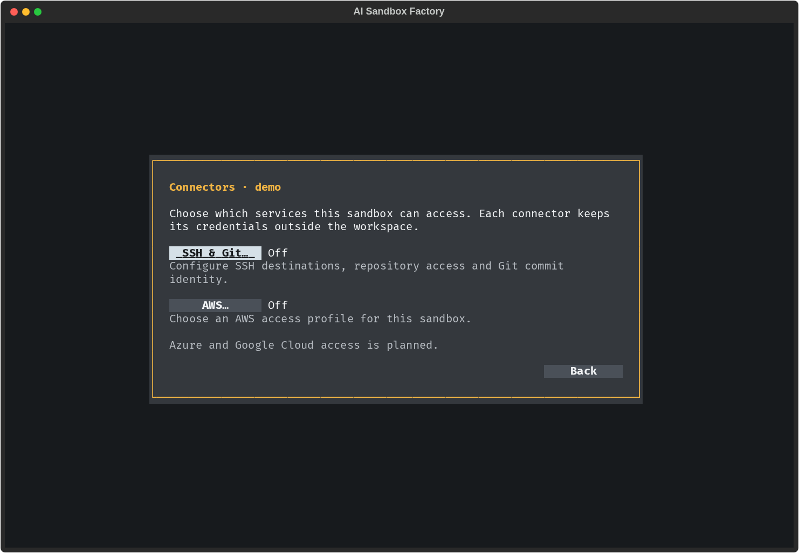
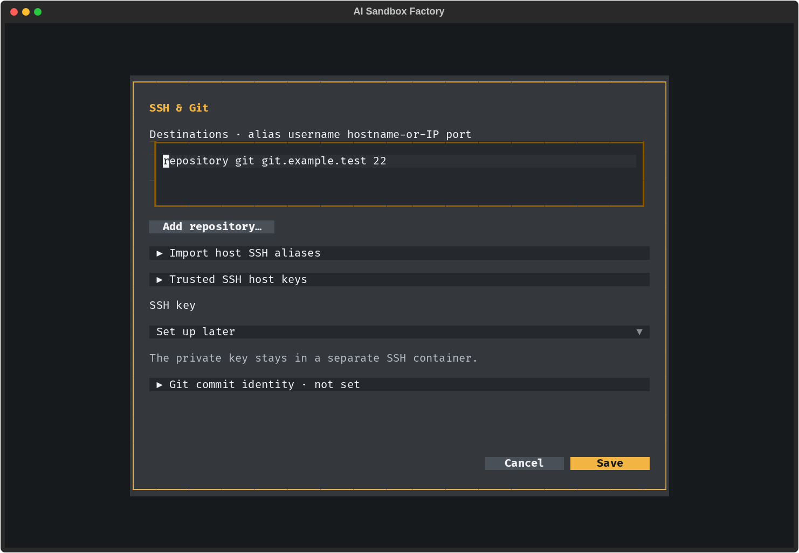
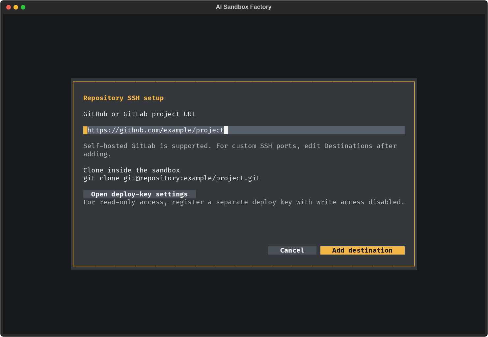
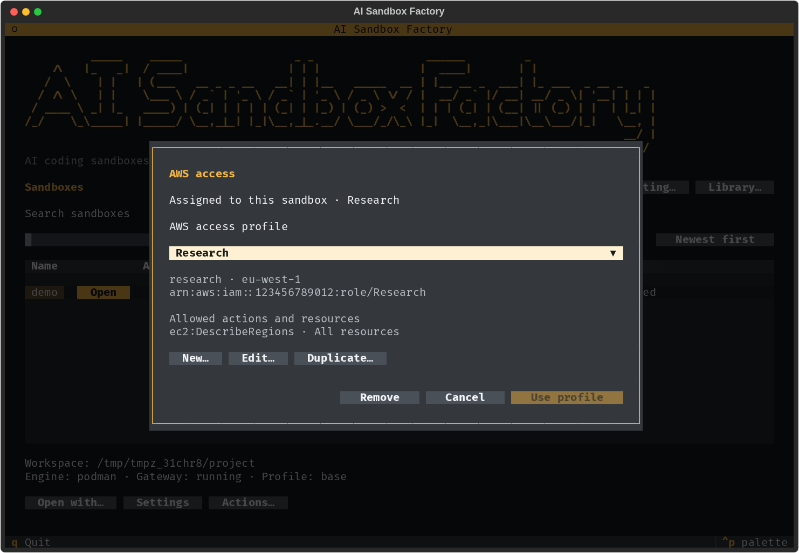
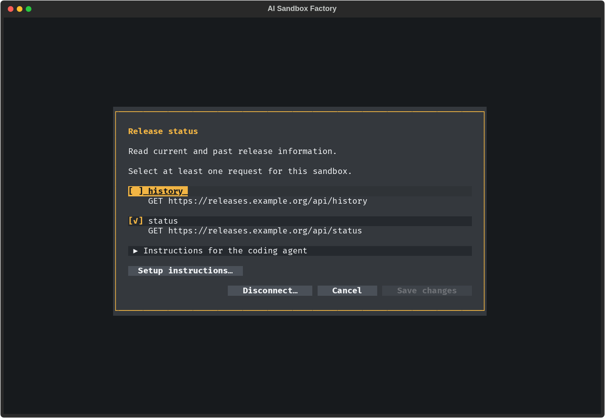

# Connect a sandbox to a service

Open **Review sandbox → Connectors** during creation, or **Settings → Connectors** for an existing sandbox. Choose the service and the access that sandbox needs. Any process in the sandbox can use the access you grant.

| Connector | What the sandbox can do | Where the credentials stay |
| --- | --- | --- |
| SSH & Git | Connect to the SSH users and hosts you select. The server controls shell, repository and branch permissions. You can set a Git commit author here even if you grant no SSH access. | A separate SSH container holds the private key. [SSH setup](ssh.md) · [Git repository access](repository-access.md) |
| AWS | Use the AWS CLI or Boto3 with the actions and resources in a saved access profile. AWS also enforces the role’s permissions. | Your sign-in stays on your computer. A separate container signs requests with a temporary role session. [AWS setup](aws-access.md) |
| Installed HTTPS connectors | Make the requests you select for this sandbox, such as reading a build result. | Your computer’s keyring stores the service token. A separate container sends it to the service. |

Azure and Google Cloud access is planned. The available connectors appear in the same place for Pi, Codex, Claude Code and Antigravity.



## Connect to an SSH host

Open **SSH & Git…**. Add the SSH destinations this sandbox may reach and supply their trusted host keys. Generate a key for this sandbox or import an existing key from your computer. The private key stays in a separate container; the agent connects through the aliases you configured. [SSH setup and key management](ssh.md#ssh-setup)



## Give the agent Git access

In **SSH & Git…**, choose **Add repository…** and enter its GitHub or GitLab URL. Register the sandbox's public key as a deploy key on that repository. The Git server controls whether it can read or push. Open **Git commit identity** in the same form to choose the author name and email. [Repository setup](repository-access.md) · [Commit identity](ssh.md#commit-identity)



## Give the agent AWS access

Sign in with AWS CLI on your computer, then open **AWS…**. Choose **New…** to save a profile with your host AWS profile, a dedicated IAM role, a region and the allowed actions and resources. Save it and choose **Use profile**. The sandbox can use AWS CLI and Boto3 within those permissions; your sign-in stays outside it. [AWS setup and permissions](aws-access.md)



Use **Library → AWS access** to edit or duplicate profiles. After an edit, choose which sandboxes receive the update. Other sandboxes keep their existing permissions.

## Give a sandbox access to an HTTPS service

1. Install a connector for the service on your computer. This guide uses **Build status**, a fictional service. To try the example with your own build service, replace its example URLs before installing it.
2. Run `ai-sandbox-factory connector-login build-status` on your computer. Check the service URLs and enter your token at the hidden prompt.
3. In **Connectors**, open **Build status…**. Select the requests the sandbox may make. For example, selecting only **latest** lets the sandbox read the latest build result. Choose **Add** when creating a sandbox or **Connect** in Settings.
4. To change access later, open the same connector in Settings, change the selected requests and choose **Save changes**. New requests use the new permissions immediately in a running sandbox. A stopped sandbox uses the new permissions when you start it. **Disconnect** removes access for this sandbox. Other sandboxes keep their settings.



Each sandbox keeps a copy of the connector it uses. Installing a new version on your computer leaves existing grants in place. To use the new version, disconnect the old version in that sandbox, check the new service URLs, then connect it again and choose the requests to allow. When you copy a sandbox, the new sandbox starts with HTTPS connectors off.

### Use the CLI

To create a sandbox that can read only the latest build, run this from your project folder on the host.

```sh
ai-sandbox-factory create research --workspace "$PWD" --connector build-status:latest
```

Separate several request names with commas, as in `--connector build-status:latest,test-results`. Using `--connector build-status` grants all requests in the installed manifest. Repeat the flag to grant access to another service.

For a saved sandbox, run `ai-sandbox-factory update research --settings-file grants.json`. List every HTTPS connector the sandbox should use in `connector_ids`. In `connector_operations`, list the requests for each new connector and any existing connector you want to change. Other retained connectors keep their permissions. This example switches an existing grant from **latest** to **test-results**. The two `expected_` fields prevent overwriting someone else’s changes.

```json
{
  "expected_connector_ids": ["build-status"],
  "expected_connector_operations": {"build-status": ["latest"]},
  "connector_ids": ["build-status"],
  "connector_operations": {"build-status": ["test-results"]}
}
```

### What the agent sees

The agent gets a short description of the access you granted. SSH lists destination aliases, users, hosts and ports. AWS lists the role, region, actions and resources. An HTTPS connector lists commands for the selected requests. A Git commit author on its own adds no connector instructions.

The full list of commands and any longer plugin instructions are in `/opt/pi-security/config/connectors.md` for Pi, or `/run/primary-runtime/connectors.md` for Codex, Claude Code and Antigravity. For example, a Pi sandbox with **latest** enabled can run:

```sh
curl --fail-with-body --unix-socket /opt/pi-security/config/connectors/build-status/api.sock http://localhost/latest
```

The other agents use `/run/primary-runtime/connectors/build-status/api.sock`. In Pi’s inner shell sandbox, connector sockets require a reviewed `bash_escalate` call. If approvals are off, the agent cannot reach the socket from that shell.

In a sandbox created with this version, Pi reads updated instructions when you send your next message. Other agents read them when you next launch the agent. The connector enforces the selected requests as soon as you apply the change.

## Build an HTTPS connector

Start with the [Build status manifest](../examples/connectors/build-status/connector.json). Replace its example URLs with HTTPS endpoints you trust to receive the token. Choose endpoints whose response bodies the sandbox may read. A connector can grant access to a service independently of the sandbox’s ordinary browsing rules.

Install the file at `~/.config/ai-sandbox-factory/connectors/<id>/connector.json`. If you set `XDG_CONFIG_HOME`, use that directory in place of `~/.config`. Open Connectors again to see the service.

| Manifest field | What to enter |
| --- | --- |
| `version` | The number `1`. |
| `id` | The name of the enclosing folder. Start with a lowercase ASCII letter, then use lowercase letters, digits or hyphens. Built-in identifiers are reserved. The full socket path `/opt/pi-security/config/connectors/<id>/api.sock` must fit the 107-byte Unix socket pathname limit. |
| `title` | The service name shown in Connectors. |
| `description` | A single line explaining what the sandbox can do with this service. |
| `documentation` | Plain-text setup instructions shown under **Setup instructions…**. Include the permissions the service token needs. |
| `operations` | One or more named GET requests. Names follow the same character rules as `id`. Use an exact HTTPS URL, or an object with `url` and optional `instructions`. |
| `agent_instructions` | Optional plain text for the coding agent. Use it for guidance that applies to every request. Put advice about individual requests under that operation’s `instructions`. |

All fields except `agent_instructions` are required. The loader rejects unknown fields. URLs must be printable ASCII with a hostname. A fixed query string is allowed. Omit user names, passwords, fragments and secrets such as signed query parameters. The user can review the agent instructions before enabling the connector.

For example, this `operations` field gives the agent extra guidance when the sandbox has permission to request test results.

```json
{
  "operations": {
    "test-results": {
      "url": "https://builds.example.org/api/projects/release/tests",
      "instructions": "Report the names of failed tests and their build numbers."
    }
  }
}
```

The connector makes the selected GET request with its bearer token. Callers cannot choose another URL, supply a request body or forward headers such as `Accept`. On success the connector streams the service’s response body and status with `Content-Type: application/octet-stream`. It does not forward the service’s response headers or follow redirects.

### Troubleshooting

| What you see | What to do |
| --- | --- |
| The service is missing from Connectors | Check that the folder name matches `id` and the file is named `connector.json`. Reopen Connectors. An invalid manifest produces a message beside the list. |
| A token is missing or the keyring is locked | Unlock your computer’s keyring and run `ai-sandbox-factory connector-login <id>` on the host. Enter a bearer token for the listed URLs, then choose **Check again** in the dialog. Changing the operation names or URLs requires saving a token for the new set. |
| The connector returns HTTP 404 | Check the operation name and the requests allowed in this sandbox. Use the command in its `connectors.md` file. |
| The connector returns HTTP 502 | Read the error message. A service status such as 401 or 403 means the service rejected the request. Check the token and its permissions. A connection error means the connector could not reach the service over HTTPS. The service’s error body stays private. |

To rotate a token, run `connector-login` again. Each running connector keeps its current token until it restarts. You can disconnect and reconnect just that service, choosing the allowed requests again, or stop and start the sandbox when you are ready to interrupt its running work. A stopped sandbox reads the replacement token at its next start.

## Develop a built-in connector

The external manifest format supports bearer-authenticated HTTPS GET requests. SSH and AWS use different protocols and have dedicated implementations. Each built-in has a folder under [connectors/builtin](../ai_sandbox_factory/connectors/builtin). Its `connector.json` describes the built-in service and its availability. External plugins use the version 1 manifest above, which declares each allowed URL.

For a new protocol, implement a settings adapter in `plugin.py` and register it in `builtin.ADAPTERS`. The [SSH adapter](../ai_sandbox_factory/connectors/builtin/ssh/plugin.py) and [AWS adapter](../ai_sandbox_factory/connectors/builtin/aws/plugin.py) show the interface.

| Adapter member | Responsibility |
| --- | --- |
| `status(config)` | Describe this sandbox’s selection beside the service name. |
| `draft_editor(draft, connector)` and `apply_draft(draft, value)` | Open the creation form and store its accepted choices in the draft. |
| `saved_action` | Identify the existing Settings action that applies changes to a saved sandbox. |
| `hint(config)` | Describe the access actually granted to the agent. Return `None` when no service access is enabled. Use the full reference for longer guidance. |

The adapter handles the UI and agent instructions. Connect the new protocol to sandbox creation, startup, update, stop and cleanup separately. The SSH and AWS credential containers are managed by [sandbox_ssh.py](../ai_sandbox_factory/sandbox_ssh.py) and [aws_access.py](../ai_sandbox_factory/aws_access.py). Test allowed and denied operations from inside a sandbox, how it recovers from a failed change, and where a workspace process can read credentials. Installing an external JSON manifest never loads Python code from that folder.
