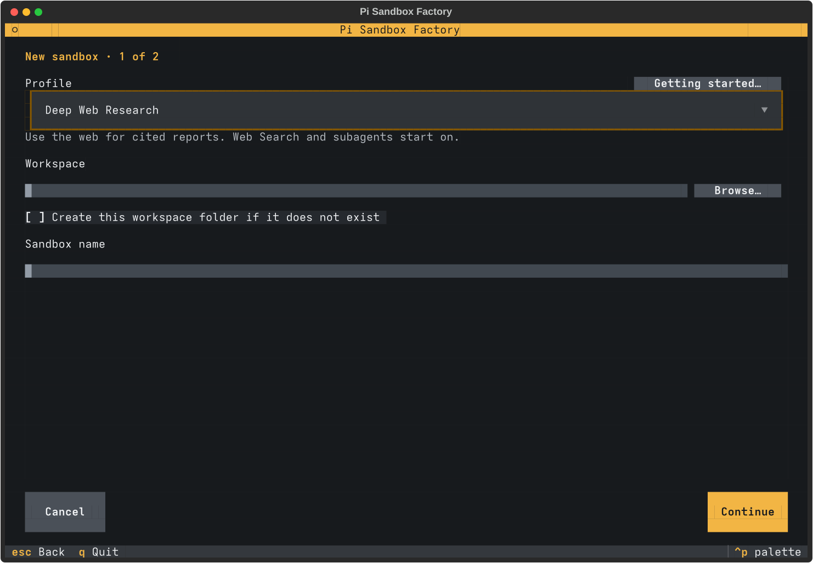
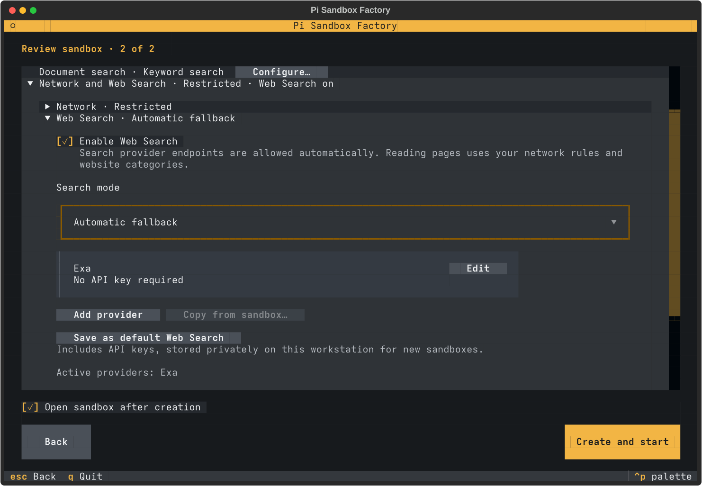

# Deep Web Research

Use this profile to investigate a question and save a cited report. It includes
the `deep-research` skill and enables Web Search and subagents by default. Web
Search uses `pi-web-access` to find sources. Pi can also read local references.
[pi-web-access package](https://github.com/nicobailon/pi-web-access)

## Set up web research

1. Choose **New sandbox → Deep Web Research** and select a writable **Workspace**
   for the report. Choose **Continue** and connect a model under **Model Providers**.
2. In **Review sandbox → Network and Web Search → Web Search**, choose your
   provider. **Automatic fallback** starts with keyless Exa. Use **Add provider**
   for another service or choose an **Only…** mode to send every search to one
   provider. [Search providers](web-access.md#web-search)
3. Keep **Network mode** on **Restricted**. Under **Network**, either select
   **Python** in **Website categories** or leave categories off and enter
   `docs.python.org:443` under **Additional allowed destinations** for just that
   website. Categories and host entries add to each other. Factory separately
   allows the search provider. It can return snippets from other sites, while
   direct page reads follow your network rules. [Website access](web-access.md#network-access)
4. Choose **Create and start**. Open Pi or FrostPi. The startup hint tells you
   how to begin. Type `/profile-guide` for a sample question and setup instructions.

## Ask for a report

> Compare Python’s JSON and TOML readers. Use only official Python documentation.
> Save a cited report with a short summary and a list of sources.

Open `report.md` and `sources.md` in the `research/<topic>/` folder Pi creates in
your workspace. Check `sources.md` to see where each claim came from. If Pi
finds a result but cannot open it, allow that host explicitly or ask Pi to use
other sources.

For a broad question, Pi can delegate independent parts of the research. Change
**Enable optional subagents** under **Agent tools** if you want one agent to do
the work. To use local documents alongside web sources, add a read-only folder
under **Folders** and name it in your request. Keyword search works immediately.
Optional `pi-knowledge` adds an index for semantic search. [Local document setup](local-knowledge.md)
