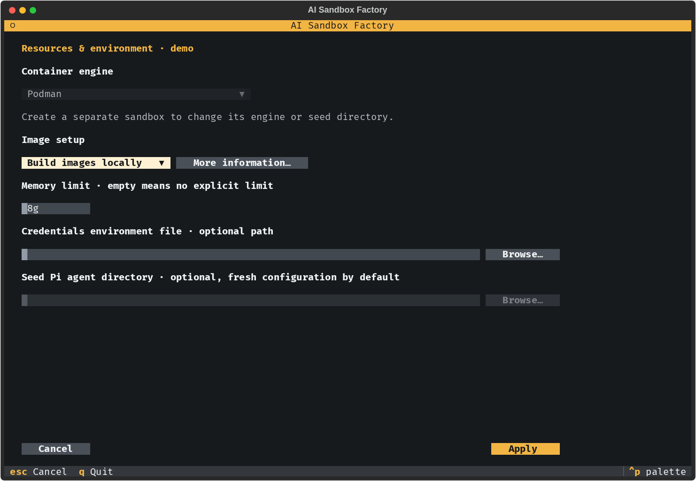

# Image setup

Open **Resources & environment → Image setup** when creating a sandbox or editing
its settings. The choice affects future builds; saving it does not restart the sandbox.



| Choice | What happens |
| --- | --- |
| **Use prebuilt images** | Factory reuses or downloads compatible images from the tested list shipped with your Factory release. Stages without a matching image build locally. |
| **Build images locally** | Factory uses its local recipes and the container engine's normal build cache. It does not download Factory's published images. |

Both choices can download upstream base images and packages. Local builds do not
force a reinstall without cache or select newer versions than the recipes specify.
An image already available locally can avoid downloading its layers again.

The Pi stock image includes Betterwright and the browser editor.
Your saved settings still choose which agent integrations are enabled. Installed
executables remain available to shell commands. Credentials and sign-ins are
created separately for each sandbox; they are not included in published images.

If downloading a matching image fails, Factory reports the image and engine error.
Retry, or select **Build images locally** and retry the build. A failed download
does not silently start a potentially long local build.

## Custom profiles

Custom profiles keep their Dockerfiles and build order. Factory can reuse a
prebuilt common base, then builds the profile and selected additions locally.
Editable profiles still require **Review changes… → Apply profile changes**.
Profile services keep their own image or Dockerfile and separate data volumes.
[Profile setup](profiles.md)

Factory records the actual images used with the applied profile. Changing the
image preference or publishing newer images does not change a running sandbox.

## Container updates

The dashboard’s **Updates** column compares applied builds with your installed
Factory version. **Available** opens a review of the affected containers; choose
**Update containers** to prepare and apply them. Upgrade Factory first to receive
newer recipes and tested image versions. Checking does not contact a registry.

Both image setup choices are supported. Prebuilt updates use the tested image
digests; local updates build the installed recipes. Changing the image setup
choice alone does not count as an update. Downloading or building an image does
not clear the flag until it is applied.

Only containers used by the sandbox are checked. Helper-only updates leave the
main agent sandbox and browser editor running. When the main agent sandbox must
be replaced, the review names the interruption before you apply. Its browser
editor restarts at the same address. Stopped sandboxes stay stopped. Preparation
or startup failure restores the previous runtime.

Tracking covers the bundled **Default Developer Sandbox**, **Developer + PostgreSQL**,
**Deep Research** and **Local Knowledge** profiles. **Custom profile** means you
maintain that profile’s Dockerfiles, software, services and rebuilds, including
security updates. This includes editable profile copies. Factory continues to
manage its credential containers and network controls. **Cannot compare** means
applied version evidence is missing or cannot be read; open the entry for the
specific cause and next step.

```sh
ai-sandbox-factory list --updates
ai-sandbox-factory inspect dev --section updates --json
ai-sandbox-factory update-containers dev --preview --json
ai-sandbox-factory update-containers dev --revision REVIEW_ID
```

Use the `revision` returned by the preview. Factory checks it again before
preparation so a changed sandbox or target requires a fresh review.

## Command line

```sh
ai-sandbox-factory create dev --workspace "$PWD" --image-source prebuilt --start
printf '{"image_source":"local"}\n' | ai-sandbox-factory update dev --settings-file -
ai-sandbox-factory build dev --image-source prebuilt
ai-sandbox-factory recreate dev --image-source local
```

The `build` and `recreate` flags override the acquisition choice for that operation;
they do not change the saved preference. An acquisition-only override keeps the
saved profile and provider sources. **Create from existing** copies the preference
and applied profile, with fresh private state and application data.

## Build and promote public images

Maintainers use the same Python builders and container recipes as local builds:

```sh
PYTHONPATH=. .venv/bin/python scripts/build_factory_images.py \
  --roles pi-stock gateway inference ssh --output /tmp/factory-images.json
```

The command builds public Factory roles and runs their smoke checks. It reads
bundled sources, never users' profile folders, credentials or saved sandboxes.
Without `--publish`, it writes a local build report and makes no registry changes.

The **Factory image maintenance** Action checks versions and scans images daily,
then prepares updated candidates each Monday on Linux amd64. Candidates need
the exact published-image checks before their PR is ready for promotion.
[Maintenance, failure emails and older images](image-maintenance.md)

The **Factory image candidates** Action builds and tests those candidates.
To publish candidates for the current commit on a development branch, push an
`image-candidate-*` tag:

```sh
candidate="image-candidate-$(git rev-parse --short HEAD)"
git tag "$candidate" HEAD
git push origin "refs/tags/$candidate"
```

Maintainers can also select **publish** when running the Action manually on
`main`. Both paths publish under `kyuz0` on Docker Hub, pull each digest
anonymously and repeat its smoke checks before writing candidate fragments.

The Action combines successful fragments into a candidate `images.lock.json`.
Use that artifact for development checks with `--candidate-index`, as described
in [TESTING.md](../TESTING.md#image-preparation). To promote an image set, run
**Factory image maintenance**. It records the source and verification evidence
with the exact image list before opening the reviewed update. Copying the image
list alone is insufficient for a release. Candidate publication does not change
the installed list or update live sandboxes.

Each entry matches the role's source files, executable modes, build arguments and
container platform. The workspace and its credential companions remain separate.
Do not add private profiles or providers to the public candidate workflow.
