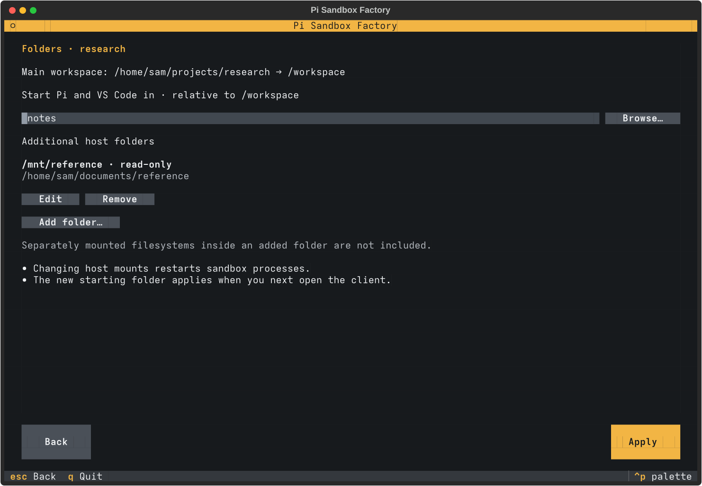
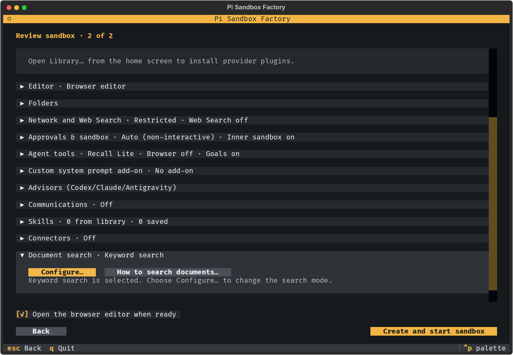

# Local Knowledge

Use **Local Knowledge** to ask Pi questions about your documents. Its
`local-knowledge` skill searches by file name and text and cites the sources.
You can start with a folder. Keyword search needs no index or embedding model.

Document search works with every Pi profile. Local Knowledge adds research
instructions and a skill that guide Pi to index, search and cite your documents.

## Search a document folder

1. Choose **New sandbox**, keep **Pi** as the coding agent, and select the **Local Knowledge** profile. Pick a writable **Workspace** for
   reports and notes, then choose **Continue**.
2. Under **Folders → Add folder…**, select your documents. Name the mount
   `reference` and leave **Read-only** checked. Pi will see it at `/mnt/reference`.
3. Open **Document search**, near the end of **Review sandbox**, before **Resources & environment**. Keep **Keyword search** to start without an embedding model.
   Choose **Configure…** to turn on semantic search, or **How to search documents…** for setup help.
4. Under **Network and Web Search**, leave **Web Search** off. Choose **Restricted**
   networking and leave website categories and additional destinations empty.
   [Network rules](web-access.md#network-access)
5. Choose **Create and start sandbox**.

Try asking “Which files in `/mnt/reference` explain how to onboard a new team
member? Cite the file and section.” Type `/profile-guide` for the profile’s
instructions in chat.

## Turn embeddings on

Semantic search uses an embedding model to find related passages even when the
wording differs. Factory installs `pi-knowledge`. When you index files, Pi sends passages to the embedding
provider you choose. When you search the index, Pi sends your query to the same
provider. Factory downloads no embedding model. [pi-knowledge package](https://pi.dev/packages/pi-knowledge)

1. Open **Document search → Configure…** in **Review sandbox**. For an existing sandbox, open
   **Settings → Document search → Configure…**.
2. Set **Search mode** to **Semantic search**, then choose where to run it.
   - **Connected provider.** Pick OpenRouter or a supported provider plugin under
     **Embedding provider**, then choose an **Embedding model**. Factory reuses
     the connection. If the list is unavailable, enter a model ID from the provider.
   - **Custom server.** Enter the **Embedding server URL** and **Embedding model ID**.
     Use the API base URL, such as `https://models.example.org/v1`. Factory adds
     `/embeddings`. [Custom server screenshot](research-custom-server.png)
3. Choose **Save**, then **Create and start sandbox** for a new sandbox or **Apply and
   recreate** for an existing one. Applying restarts the sandbox.

For a custom server, use an address the sandbox can reach.

| Where the model runs | How to connect |
| --- | --- |
| Your workstation | Enable the server port under **Model Providers → Local models**. Use `http://local-model.internal:PORT/v1`. |
| Another server that accepts requests without a key | Enter its API base URL. In Restricted mode, allow its host and port under **Network and Web Search → Network**. |

If a provider plugin supports embedding models but is missing from the picker,
update it under **Library → Providers**. For an existing sandbox, select
**Actions… → Update sources and recreate…** to load the update. If that sandbox
uses the old offline model, switch to keyword search first. [Updating a sandbox](usage.md#update-factory-and-sandboxes)

### Index and search

Ask Pi or FrostPi “Index the documents in `/mnt/reference` so we can search them.”
Pi indexes that folder using your configured embedding service. Read-only folders
work: the source files stay unchanged and the index is saved in the sandbox's
private home. Then ask your questions and request file or section citations.

After changing the documents or embedding model, ask Pi to refresh the index.
You can also use `/knowledge-index /mnt/reference` and
`/knowledge-refresh reference` directly.

## Turn embeddings off

Open **Settings → Document search → Configure…**, set **Search mode** to
**Keyword search**, and choose **Save → Apply and recreate**. Finish any running
work before applying. Reopen Pi or FrostPi and ask about your files as before.

Pi now searches the files directly. Document search stops contacting the embedding
server. The index, including excerpts from your files, stays in the sandbox’s
private home. Turn embeddings on with the same server and model to use it again.
