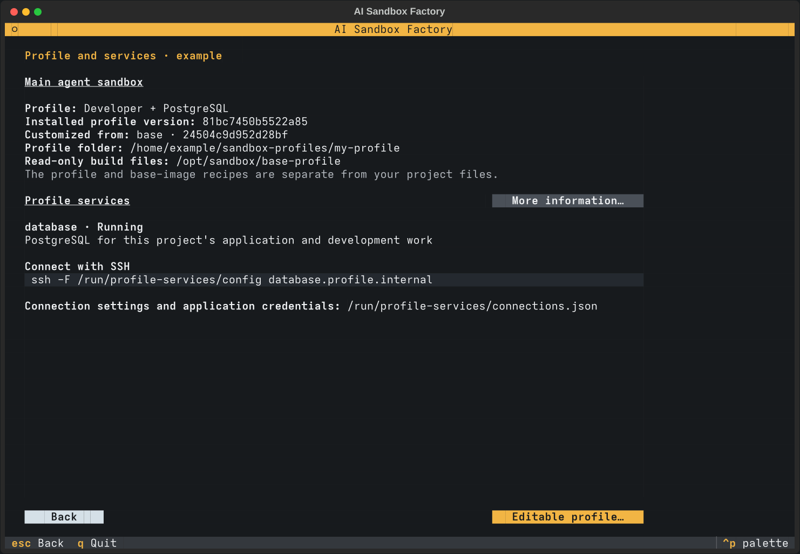

# Profiles

Choose a profile for the kind of work you want to do. A profile can add
software, skills and instructions for the selected coding agent. Pi profiles can
also add Pi extensions. For Pi, choose model providers separately so the same
profile can work with a local or hosted model.

## What profiles inherit

**Default Developer Sandbox** is the built-in profile (`base`). Its main agent sandbox
includes Node.js, Python, Git and document tools. Factory adds the selected coding
agent; Pi sandboxes include Pi, FrostPi and the Pi sandbox components.

Custom profiles extend that base image with their own dependencies, skills and
instructions. They do not inherit other profiles’ additions.

## Research profiles

- **Local Knowledge** answers questions about your documents and code. Keyword
  search is available immediately. Web Search starts off. [Local Knowledge](local-knowledge.md)
- **Deep Web Research** enables Web Search and subagents. Ask it to investigate a
  question and write a cited report using web or local sources. [Deep Web Research](deep-web-research.md)

For an existing research sandbox, **Actions… → Update sources and recreate…**
installs the current profile and adds its **Getting started…** guide.

The profile’s Dockerfile starts with `ARG BASE_IMAGE` and `FROM ${BASE_IMAGE}`.
The launcher supplies that image, then adds the selected browser support,
providers and extra skills after building the profile.

## Install and update

```sh
ai-sandbox-factory profile add reporting ./examples/profile
ai-sandbox-factory profile list
ai-sandbox-factory profile show reporting
ai-sandbox-factory create reports --profile reporting --workspace /absolute/path/to/reports \
  --local-model-ports 8000 --allow-domain local-model.internal:8000 --start
```

Replace the folder with a Git HTTPS or SSH URL to install from a repository.
For a repository containing several plugins, select the folder:

```sh
ai-sandbox-factory profile add reporting git@git.example.com:team/plugins.git --subdir reporting
```

Factory installs the selected subfolder and uses that same folder when you
update the profile. To stick to a tag or commit, pass `--ref TAG_OR_COMMIT`.
Factory uses committed files from a local Git repository, so commit your edits
before updating. For an ordinary folder it uses the files as they are.

```sh
ai-sandbox-factory profile update reporting
ai-sandbox-factory recreate reports --profile reporting
```

Use `profile update` for profiles and `provider update` for provider plugins.
The update fetches the selected branch or ref. `recreate` builds the updated
image before stopping the old main agent sandbox. It keeps the project folder, saved chats and private home; unchanged
profile services keep their running or stopped state. Close the editor first. Updating a pinned
commit keeps that commit.

`ai-sandbox-factory profile remove reporting` removes the registration while
preserving existing sandboxes and their saved profiles.
**Library → Profiles** provides the same install, update and remove operations in the TUI.
Choose **Details…** on a profile to read its system prompt addendum.

## Write a profile

The [profile authoring guide](../ai_sandbox_factory/containers/dev/profile-authoring/README.md)
includes a complete two-host example, the service fields, Dockerfile requirements,
SSH, networking, persistent storage and a workflow for editing and versioning a
profile outside the project repository. Several services can share one Dockerfile
or use different build folders and images.

The same guide and example are readable inside new sandboxes at
`/opt/sandbox/base-profile/authoring/README.md`. Factory tells the agent where to
find them when explaining its applied profile. Applied files are read-only.
**Actions… → Profile and services… → Make profile editable…** creates a separate writable
copy outside the project, available to the agent at `/opt/sandbox/profile`.
After editing the copy, choose **Editable profile… → Review changes… →
Apply profile changes** to install an edited image
or add, change or remove services in that sandbox. [Editing, validation and versioning](../ai_sandbox_factory/containers/dev/profile-authoring/README.md#edit-the-profile-of-an-existing-sandbox)

Attaching or applying an editable profile replaces the main agent sandbox.
An open browser editor restarts at the same address with its existing password
and connection settings. Reload that tab if it has not reconnected. Terminal
clients must be reopened. If replacement fails, Factory restores the previous
container and its browser editor before returning the error.

**Create from existing** copies the installed profile, including customizations, and starts with
separate private state and application data. Its **Rebuild sandbox…** action
keeps that saved profile; it does not fetch the original Library profile.
If the source has an editable profile, **Share the profile folder** shares its
folder. Both sandboxes see the same files, but editing them does not update either
sandbox automatically. To install edits, choose **Actions… → Profile and services… → Editable profile… → Review changes… →
Apply profile changes** in each sandbox you want to update. Databases and private state remain separate.

Copy [examples/profile](../examples/profile) into a new repository. It contains:

| File | Purpose |
| --- | --- |
| `profile.json` | `version: 1`, a lowercase `name`, and a short `description`. |
| `Dockerfile` | Extends `ARG BASE_IMAGE` / `FROM ${BASE_IMAGE}`; finishes as `USER node`. |
| `profile.md` | UTF-8 instructions included in the selected coding agent’s managed context from the saved profile. |
| `system-prompt.md` | Optional UTF-8 Markdown describing what the profile is intended for. Factory includes it in the Pi system prompt. |
| `start-here.md` | Optional UTF-8 user guide shown under **Getting started…** in Factory and `/profile-guide` in Pi and FrostPi. |
| `check.py` | Optional tool checks, copied to `/opt/sandbox/profile-check.py`. |
| `resources.json` | Skills, prompts and extensions registered with Pi. |

`profile.json` can include a one-line `summary` for the profile picker and Library.
It can also set `defaults.web_search` and `defaults.subagents` for new sandboxes.
Each is a boolean. Users can change both in configuration.

Start `start-here.md` with a short plain-text paragraph that gives the user a
first action. Pi shows that paragraph when it opens a fresh chat. Put examples
and setup steps below it. Factory serves the guide from the saved profile and
keeps the workspace available for the user’s own files.

Keep the addendum short. Factory identifies the profile and explains that the user
can take the work in another direction. The addendum comes from the saved profile
snapshot and is included with the existing instructions in Pi CLI and FrostPi.
Factory reads it directly from the profile, so its Dockerfile can stay as it is.

Install dependencies during the image build. Put profile resources under `/opt`
and copy `resources.json` to `/opt/sandbox/resources.json`, for example:

```json
{"skills":["/opt/reporting"],"prompts":[],"extensions":[]}
```

Skills are folders containing `SKILL.md`. Extensions are Pi extension files or
folders. Prompts are Pi prompt files or folders. They must exist in the built
image. Pi and FrostPi read the same registrations. Replacing a profile removes
its old launcher-managed registrations while preserving user-added resources.

If the tools live in another repository, add `git_source` and optionally `git_ref`
to `profile.json`. Installation exports that repository and its submodules into
`source/`, with the dependency commit recorded in the registry. Reserve that directory
for the dependency; use `COPY source/ ...` in the Dockerfile. Git credentials and
`.git` directories are excluded from the image inputs.

Keep service-specific setup in the profile's README and agent instructions.
Use `ai-sandbox-factory exec NAME -- COMMAND ...` to configure a tool inside its sandbox;
add required destinations through **Settings → Network and Web Search → Network** first.

## Check it

Install the example, create a disposable sandbox and run:

```sh
ai-sandbox-factory check reports --allowed-url http://local-model.internal:8000/v1/models
```

The endpoint must be running and allowed. This checks the container boundaries,
common tools and your `check.py`. Open Pi/FrostPi and confirm the skill loads.
Delete the disposable sandbox afterward; its project folder is kept.

## Applied recipes and coding agents

**Actions… → Profile and services…** identifies the sandbox's saved profile and
lists its profile services. The coding agent can read the exact profile files
used for its image at `/opt/sandbox/base-profile/profile/`. Its base build inputs and
`build.json` are in the same read-only directory. These files are separate from
`/workspace` and its project instructions. Factory adds this location and the
profile revision to the selected coding agent's managed instructions.

Factory includes the full saved `profile.md` in every compatible agent's managed
instructions. Pi CLI and FrostPi receive it through Pi's global `AGENTS.md`;
Codex receives it through `developer_instructions`; Claude Code through its
configuration directory's `CLAUDE.md`; and Antigravity through its configuration
directory's `AGENTS.md`. The project's `/workspace/AGENTS.md` is not changed.
The optional `system-prompt.md` addendum remains specific to Pi.

Existing profiles remain Pi profiles unless they declare an `agents` list:

```json
{"version": 1, "name": "developer", "description": "Developer tools", "agents": ["pi", "codex", "claude", "agy"]}
```

The built-in Default Developer Sandbox and Developer + PostgreSQL support all
four coding agents. A portable profile adds tools through `ARG BASE_IMAGE` and
finishes as `USER node`. Pi extensions and Pi-specific resources require Pi;
declaring other agents does not translate those extensions.

<a id="application-containers"></a>

## Profile services

**Review sandbox** lists the services included in the selected profile.
Choose **More information…** beside the list for startup and application-data
details. The same help is available in **Actions… → Profile and services…**.



Choose **Developer + PostgreSQL** for a sandbox with a database. The database
starts with the sandbox and is reachable at `database.profile.internal:5432`.
Read `/run/profile-services/connections.json` inside the main agent sandbox for its
application username, database and generated password. The agent can use those
credentials. Factory-managed model, SSH connector and cloud credentials stay in
separate Factory helper containers.

The main agent sandbox has administrative SSH access to the actual database container:

```sh
ssh -F /run/profile-services/config database.profile.internal
```

Factory supplies the identity, batch mode and trusted host key in this config.
No extra SSH options or manual fingerprint setup are needed.

Pi uses its existing `bash_escalate` tool for this direct connection when the
inner sandbox is enabled. The configured approval mode still applies. With
approvals off, use a sandbox terminal or enable approvals. Codex, Claude Code,
Antigravity and sandbox terminals connect directly to the profile host. Follow
any shell approval required by the selected coding agent.

Profile containers share one private network with the main agent sandbox. They can
connect to each other directly, including ping, database clients and SSH. Their
external requests use the sandbox's approved proxy destinations. Factory does
not publish application ports on the host or give profiles control over
Factory helper containers. Profile services currently require rootless
Podman and Restricted networking.

Add optional `services` to `profile.json`. The profile’s top-level Dockerfile
for the main agent sandbox is not listed in `services`. Each service chooses
an existing image or a build context. Add one entry per host; the
[complete two-host example](../ai_sandbox_factory/containers/dev/profile-authoring/example/profile.json)
uses separate data and credentials for each:

```json
{
  "services": {
    "database": {
      "description": "Application PostgreSQL database",
      "build": {"context": "services/database", "dockerfile": "Dockerfile"},
      "environment": {
        "POSTGRES_DB": "app",
        "POSTGRES_USER": "app",
        "POSTGRES_PASSWORD": {"generate": "database-password"}
      },
      "volumes": {"data": "/var/lib/postgresql/data"},
      "healthcheck": ["pg_isready", "-U", "app", "-d", "app"],
      "connections": {
        "port": 5432, "database": "app", "user": "app",
        "password": {"environment": "POSTGRES_PASSWORD"}
      }
    }
  }
}
```

An image declaration uses `"image": "registry.example.com/team/service:version"`
in place of `build`. Factory records its resolved image ID for the sandbox.
Build contexts are relative to the profile. A Dockerfile path is relative to
its build context. Optional
`command` overrides the image command with an argument list; the original
entrypoint remains in use. Like the profile’s top-level Dockerfile, service
Dockerfiles are trusted build inputs executed by the host container engine.

Each service image must supply a shell and an OpenSSH server. Factory starts
that server inside the profile container with a sandbox-specific key and
pinned host key; the application's entrypoint remains PID 1. The optional `ssh`
object selects `port` (default 22), `user` (default root) and `server` (default
`/usr/sbin/sshd`). The chosen account must exist and allow public-key login.
For PostgreSQL, see the runnable built-in
[profile](../ai_sandbox_factory/profiles/developer-postgres/profile.json) and
[service Dockerfile](../ai_sandbox_factory/profiles/developer-postgres/services/database/Dockerfile).

`healthcheck` runs inside the service until initialization succeeds. An exited
service or a missing check command produces an error with its diagnostic output.
A creation job can be cancelled while initialization is running.
`environment` accepts strings and generated values. `connections` contains
agent-readable text, numbers and references to those environment values.
`volumes` maps persistent volume names to paths inside that service. Factory
chooses the engine names, mounts, private network and proxy settings.

### Application credentials

Keep passwords out of shareable profiles. Declare `{"generate": "database-password"}`
instead of a password string, as above. Factory generates and saves the value in
the sandbox's private state, outside the profile folder, and injects it into
that service container's environment. Generated values belong to one sandbox
and service; using the same name in another service does not share the password.

The agent's managed instructions point to `/run/profile-services/connections.json`;
they do not contain its passwords. An application in the main agent sandbox
can read that file and use its values at runtime. Factory does not automatically
set application environment variables there. **Resources & environment → Credentials
environment file** supplies user-selected variables to the main agent sandbox
only, not to profile services.

Automatic injection of a shared password into several service containers is not
supported yet. See the [profile authoring guide](../ai_sandbox_factory/containers/dev/profile-authoring/README.md#environment-variables-and-application-passwords)
for environment routing and credential handling.

Stopping and starting a sandbox keeps its profile containers, application data,
generated passwords and SSH keys. A rebuild keeps running profile services running and leaves a stopped sandbox
stopped when it finishes. If a rebuild fails, Factory restores the previous main agent sandbox,
Factory helper containers and settings. **Editable profile… → Review changes… → Apply profile changes**
can add, replace or remove services. Review lists affected services and the data
volumes that will be kept. Factory builds images before stopping affected
services. Replacements use copies of their declared data volumes; a failed
preparation or startup restores the previous containers and settings.

Removing a service removes its container. Its data volumes remain available for
recovery until **Delete sandbox**. Factory also keeps the previous volumes when
replacing a service. Data outside
declared volumes does not survive service replacement. Factory does not perform
application-specific data migrations, such as a database major-version upgrade.
Description and connection metadata can be updated without replacing the service.
A normal rebuild uses the saved applied service layout.

### Find, export or restore previous service data

Open **Actions… → Profile and services… → Saved service data…**. Factory lists
each service's saved data with its date, source image, profile version and data
volumes. Saved data remains available after removing all services.
These are Podman volumes on your computer, separate from your project files.
Factory keeps them when you apply changes that replace or remove a service,
and before restoring saved data. This is not a scheduled backup of running services.

- **Export data…** saves a selected volume to a new `.tar` file on your computer.
  It leaves the saved volume and running services unchanged. Export each volume
  when the saved service has several.
- **Restore data…** copies the saved volumes into a selected service. Review the
  source image, current image and data paths before confirming. Only that service
  stops during restore; its current data is kept as another entry in **Saved service data**.
  Other services and coding-agent sessions keep running.
- If the service was removed, add it back through **Editable profile… → Review changes…
  → Apply profile changes**, then restore its saved data. You can export its data
  without adding it back.

Restore changes application data, not the service's current image, profile or
connection settings. The target service's current image must read the saved data
format. If necessary, change its image through **Editable profile… → Review changes…
→ Apply profile changes** before restoring. Factory
does not convert database versions or passwords stored inside application files.
If restore fails, Factory restores the previous container, SSH access and data.
After an interrupted worker, the next Start or Open completes recovery before
using the sandbox. Factory briefly starts even a stopped service to check the
restored copy, then stops it again. Saved source
volumes remain unchanged. **Delete sandbox** removes both current and saved service
data; exported archives outside Factory's state folder remain on your computer.

For the CLI, `ai-sandbox-factory service-data-list NAME` prints the saved IDs and
volume keys. For example:

```sh
ai-sandbox-factory service-data-export NAME --saved ID --volume data --output database.tar
ai-sandbox-factory service-data-restore NAME --saved ID --service database
```

**Create from existing…** reuses the source sandbox's settings and saved profile
when that profile supports the selected coding agent. It creates new application
data volumes, SSH keys and passwords. Existing
application data is not copied. Each service initializes its new volumes as its
image defines: the built-in PostgreSQL service starts with an empty `app` database;
a custom image may load seed data. **Delete sandbox** permanently deletes the
sandbox's private data, including application data. Export database data before
confirming deletion; chat-history export does not include application databases.
