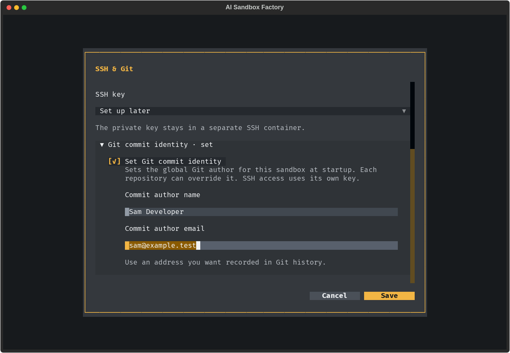
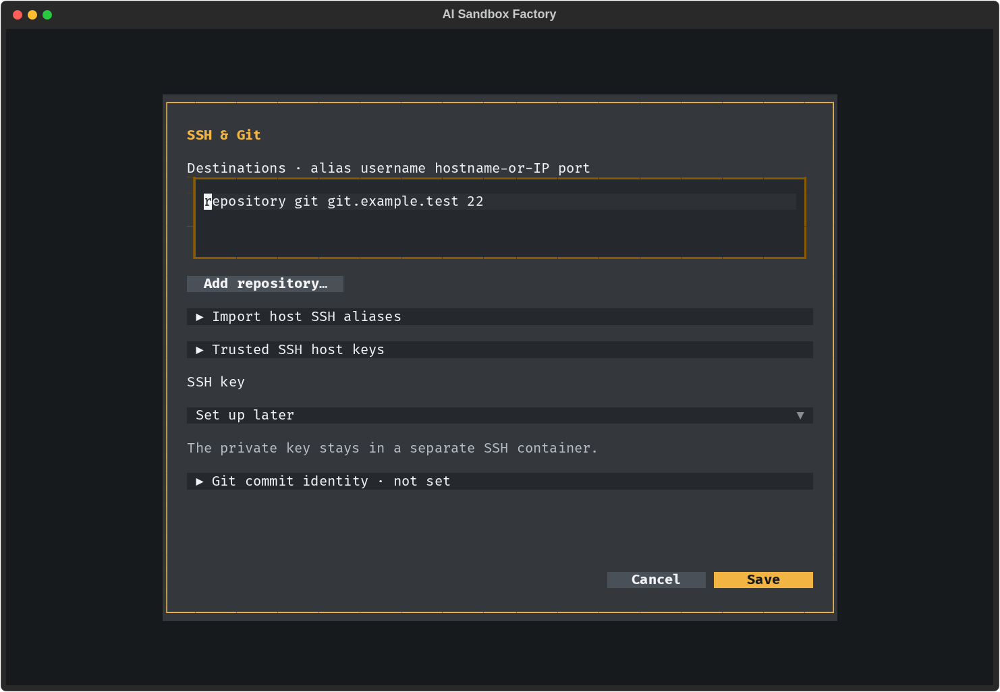
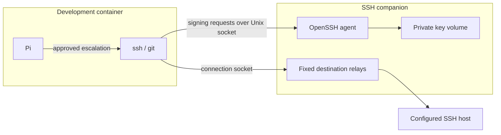

# SSH and Git repositories

## Commit identity

During creation, open **Review sandbox → Connectors → SSH & Git → Git commit identity** and enable **Set Git commit identity**.
Enter the name and email to record on commits. For an existing sandbox, use
**Settings → Connectors → SSH & Git → Git commit identity**, then apply the settings.
You can also set this under **Defaults for new sandboxes**.



Factory sets the default name and email for commits inside the sandbox. If a
repository already has its own `user.name` or `user.email`, those values take
precedence. Turning off **Set Git commit identity** removes Factory’s default
and preserves any Git settings you entered yourself. Factory leaves your
computer’s Git settings untouched and only uses an identity you enter.

Creating a commit needs no SSH key or network access. SSH keys authenticate
clone, fetch and push; cryptographic commit signing is configured separately.

## GitHub over HTTPS

Enable **GitHub** under **Settings → Network and Web Search → Network → Website categories** for repository
browsing, API requests, clones and release downloads over HTTPS.
For Codex, Claude Code and Antigravity, use **Settings → Network → Website categories**.

For authenticated Git operations with an isolated private key, use SSH.

## SSH setup

In **Review sandbox → Connectors → SSH & Git**, enter destinations or import host SSH aliases. Import errors identify the rejected alias and explain the constraint. OpenSSH configuration errors include its exit status, diagnostic, and the file and line number when supplied by OpenSSH.
Choose **Generate repository key** or **Import and unlock** to set up the key
as soon as the sandbox starts. If you generate a key, Factory displays its
public half for you to register with the Git server.



For GitHub or GitLab, use **Add repository…** and follow [repository setup](repository-access.md).

1. Open **Settings → Connectors → SSH & Git**. Import aliases from your host's SSH configuration, or enter one destination per line: `alias username hostname port`.
2. Supply trusted host keys through your existing `known_hosts` file, then **Apply**. Applying destinations restarts the sandbox processes and preserves the workspace and private home.
3. Return to **SSH & Git → SSH key**, select a key outside the workspace, and choose **Import and unlock**. Enter its passphrase directly in your terminal.
4. Use the alias from the sandbox, for example `ssh build 'hostname && uptime'`. With the inner command sandbox enabled, Pi uses `bash_escalate`, subject to manual or automatic approval.

Adding a destination configures its connection route; it does not import a key.
Run `sandbox-ssh-status` in the container (through `bash_escalate` in Pi) to check
the configured destinations and whether the signing agent has an unlocked key.
`no_unlocked_key` requires **Import and unlock** or **Unlock existing key** in
Factory. Keys stay in the companion, so an absent `~/.ssh` directory is expected.
With the inner sandbox enabled and approval off, agent SSH commands are unavailable;
choose an approval mode first. Without the inner sandbox, use ordinary Bash.
Use the managed SSH configuration without overriding `GIT_SSH_COMMAND` or host-key
checking. Inner-shell DNS and TCP probes cannot test the companion's socket route.

**Generate repository key** creates an unencrypted key in the private SSH
container. If a key is already saved, Factory keeps it. To replace it, select a
key file and choose **Import and unlock**.

Keys unlock for eight hours by default. Set **Keep SSH key unlocked for** before
importing or unlocking a key to use a different duration. When the dashboard shows
a locked-key alert, open **Show Alerts → Unlock existing key**. Restarting the SSH
companion can lock an encrypted key early. Unencrypted keys load automatically
when the companion starts.

CLI key management after configuring destinations:

```sh
ai-sandbox-factory ssh-import-key NAME --key-file ~/.ssh/id_ed25519
ai-sandbox-factory ssh-unlock NAME --duration 2d
ai-sandbox-factory ssh-generate-key NAME
ai-sandbox-factory ssh-public-key NAME
```

For GitHub, configure an alias such as `github-project`, username `git`, hostname `github.com`, port `22`, and its trusted host keys. Import a key with the repository access you need. A read-only deploy key limits access to one repository.

```sh
git ls-remote git@github-project:OWNER/REPOSITORY.git HEAD
```

## Where the key stays



The development container receives sockets and public host configuration. The private key file stays in the companion. OpenSSH constrains its use to the configured users and trusted host identities. Each sandbox holds one imported key; use separate sandboxes for separate keys.

A process in the sandbox can use the signing socket while the key is unlocked,
including a malicious extension. Destination constraints restrict the SSH server
and username; they do not restrict repositories, branches or Git commands. The Git
server enforces those permissions. Use a repository deploy key or a dedicated
automation identity rather than your personal key. See
[repository permissions](repository-access.md).

Removing all destinations disables access; deleting the sandbox removes its private
key copy and companion volumes. Your original key and workspace remain on the host.
