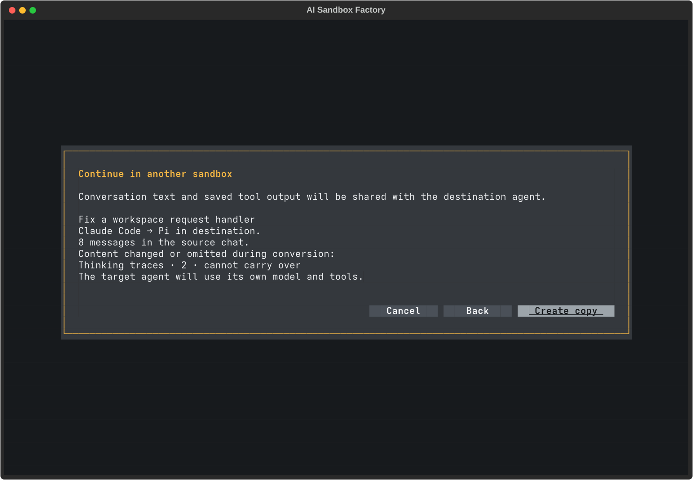
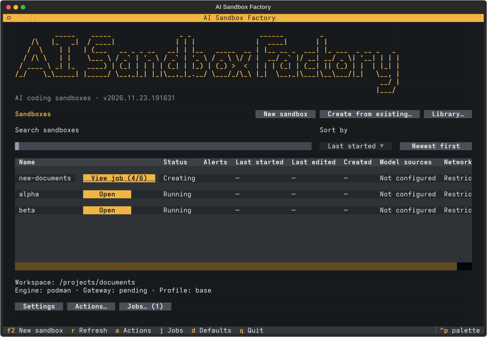
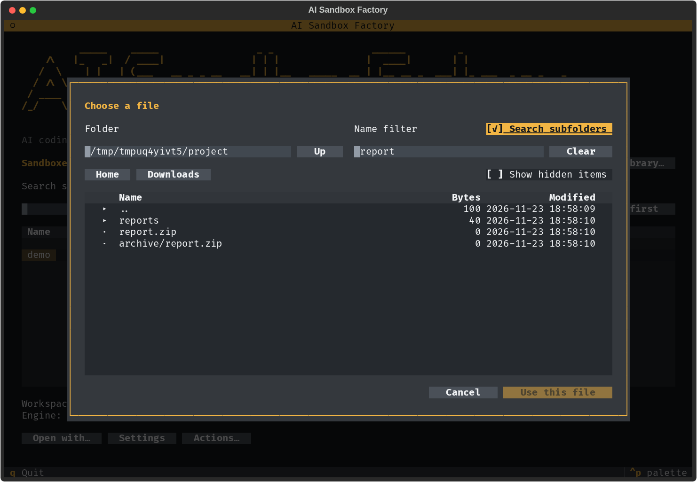

# Usage

Use Factory to create, open, and manage sandboxes. If you choose Pi, start with
**Default Developer Sandbox** for FrostPi, goal tools, and document tools.
For a different Pi setup, pick **Custom profile…** or install a profile from
**Library…**. [Create a sandbox](../README.md#create-a-sandbox)

## Choose a coding agent

Under **New sandbox → Coding agent**, select Pi, Codex, Claude Code or
Antigravity. To work with another agent later, create a separate sandbox.

For Pi, choose a profile and connect a model. Codex, Claude Code and Antigravity
use your subscription sign-in. Where supported, **Copy sign-in from this computer**
is selected by default. To start a fresh login, choose **Sign in inside the sandbox**.
For Antigravity, use personal Google OAuth. Enterprise login, Application Default
Credentials (ADC) and API keys are outside this sign-in flow.

The agent and its tools run in the workspace. A separate container keeps the
real sign-in and uses it only for the provider’s approved endpoints.
[How Factory protects the sign-in](architecture.md#native-agent-subscription-authentication)

The selected workspace is trusted automatically in the coding agent and browser editor. Pi can load its project settings, skills and extensions. Existing explicit trust decisions are preserved. Command approvals, folder permissions and network rules still apply. Project permission files cannot override Factory's rules.

Under **Review sandbox → Connectors**, choose a service to give the workspace access. Open **SSH & Git…** to set the Git commit author, add SSH destinations or configure repository access. Open **AWS…** to select an access profile. You can edit the same choices later in **Settings → Connectors**. [Connector setup](connectors.md)

If the name is already used by containers or volumes, Factory lists the conflicts
before starting creation. Go back to choose another name, or confirm removal of
the listed containers and, separately, any listed volumes. Deleting a volume
permanently removes the files it holds, which can include sign-ins and saved chats.
To keep a copy with Podman, cancel and run
`podman volume export VOLUME --output VOLUME.tar`. Replace `VOLUME` with the
listed volume name.

## Open a sandbox

Choose **Open** on the dashboard. All four agents use the browser editor by default on supported hosts. Each opens its own chat panel beside your files.

Use **Actions… → Open with…** to pick a different client for this launch. During creation,
expand **Editor** to choose the browser editor or the selected agent's CLI.
Clear the checkbox for opening your selected client if you want to open it yourself later.
For an existing sandbox, **Settings → Editor** lets you change the default client,
address, port, or password.

Pi CLI opens in your current terminal. Exit Pi to return to Factory. Pi CLI and
FrostPi use the same files, model settings, and saved chats, so you can open
either client. They start in the folder you chose under **Settings → Folders**.
[Editor setup and access](browser-editor.md)

Pi uses your first prompt to name a new chat. It asks the current model for a
short title and falls back to the first few words if the request fails. The
title appears in both clients. Use `/name` in Pi or **Rename** in FrostPi to set
it yourself.

## Copy a setup to a new sandbox

Choose **Create from existing…** beside **New sandbox**. Pick the sandbox whose settings to
reuse, then choose the coding agent and a new name. The workspace is filled in
from the source sandbox. Keep it or choose another folder. Review the profile, model providers,
network rules, features, and advisors before creating it. Factory includes the
source’s added skills. Clear any you don’t need under **Skills**.

You can choose Pi, Codex, Claude Code or Antigravity. When switching from Pi
to another agent, the new sandbox uses that agent’s sign-in flow. Choose a profile
that supports the selected coding agent. If the source profile is incompatible,
Factory selects Default Developer Sandbox; you can choose another compatible
profile. Shared choices such as folders, network rules, memory and added skills
are carried over, along with Git identity, browser and editor choices, and a custom
system prompt. Agent-specific settings use the selected agent’s defaults.
The approval choice also carries over between Codex, Claude Code and Antigravity.

Select **Include search API keys** if you want to copy those keys from a running
source. The new sandbox has its own package copies. It starts with fresh chats,
browser sessions, model and advisor logins, and SSH credentials. Select any
environment file or Pi configuration folder you want to use again.

Application data, such as databases, is not copied. Each profile service
initializes new data; Developer + PostgreSQL starts with an empty database.
Project files are not copied. Choosing the same workspace folder lets both
sandboxes edit the same host files.

## Stop, inspect, or delete a sandbox

Right-click a sandbox row to open its actions. You can also select the row and
press **A**, press **Shift+F10**, or choose **Actions…**. The menu includes
opening, settings, and controls to start, stop, update, or delete the sandbox.
Choose **Troubleshooting… → Containers…** to see what each container does
and whether it’s running. **Esc** returns from a submenu to Actions.
Press **D** on the dashboard to change the defaults for new sandboxes.

Closing Factory or the editor leaves the sandbox running. Deleting it removes
its containers, private home, saved chats, and editor settings. Your workspace
folder stays on your computer.

## Back up and restore chats

Choose **Actions… → Chat history… → Export chat history…** to save all chats from a sandbox
to a ZIP file on this computer. You can also export from the delete dialog
before deciding whether to delete the sandbox.

- **Codex, Claude Code and Antigravity.** Stop the source sandbox before
  exporting. To restore, create a sandbox with the same agent and starting
  folder. Turn off the option to open the agent when the sandbox is ready.
  Once it has started, stop it and choose **Actions… → Chat history… → Import chat history…**.
  Select the ZIP, then open the sandbox and choose a chat from the agent’s
  history. Antigravity keeps its terminal and browser histories in separate
  stores, and the backup includes both.
- **Pi and FrostPi.** Export preserves chat branches. To restore, select a ZIP
  backup or a Pi `.jsonl` file. Factory adds chats to the destination’s starting
  folder and skips chats it already has. Use **Resume session** in FrostPi or
  `/resume` in Pi to open them.

Use the same project checkout if you want the restored chat to find the files it
worked on. The ZIP contains chat history, including any text or file contents
recorded in the conversation. Store it privately. Workspace files, sandbox
settings and stored sign-ins stay outside the backup.

### Continue a chat with another agent

Stop the source and destination sandboxes. On the source sandbox, choose
**Actions… → Chat history… → Continue in another sandbox…**. Select the chat and destination,
then choose **Preview copy**. Review any content the destination cannot keep
before choosing **Create copy**. Open the destination and select the new chat
from its history.

This uses the local [`session-migrate`](https://github.com/xhluca/session-migrate) converter. The preview lists conversion
warnings and omitted content. The destination uses its own agent settings,
tools and sign-in. If it uses another project folder, earlier file paths and
edits may be absent.

The first copy builds the converter image and needs an internet connection to
download its software. Conversion runs locally without network access.



Pi, Codex and Claude Code can receive copied conversations. Antigravity's
current version cannot receive converted chats through `session-migrate`.
Its source chats are offered when the converter can read them. If it rejects
a chat's format, Factory shows the reason alongside the list of chats.

## Recover from a failed creation

Factory reports missing host dependencies at startup. The first build downloads
Pi, FrostPi and their dependencies. If creation fails, use
**Retry creation** to keep your settings or **Edit configuration** to edit
them. If cleanup fails, select the failed sandbox and choose **Actions… →
Delete sandbox…**.

**Cancel creation** removes that attempt’s containers, private volumes and
saved settings. Cancellation and failure cleanup keep your project files and
the build cache.

## Work while a job runs

Creation, rebuilds, settings updates, chat transfers, and other long operations
run as jobs. Press **Esc** or choose **Hide details** to leave the output view and
work on another sandbox. A new sandbox shows **Creating** in the list. Its
**View job** button shows the current step and total when available, such as
**View job (4/6)**. Choose it to reopen the details. The **Jobs…** button counts
running jobs. Choose it or press **J** to see running and finished jobs and their output.
Builds that share image layers take turns.



Factory keeps running while jobs are active. Wait for them or cancel the jobs that
offer cancellation before quitting. Closing the terminal can interrupt a job, and
reopening Factory starts a new job list. If the sandbox list shows **Creation
interrupted**, choose **Actions… → Delete sandbox…** before trying again. Factory
keeps your host workspace.

A count such as **Step 4 of 6 · Build sandbox images** identifies the step running
now. Its duration depends on the work, such as whether the images are cached.

If you stay on a creation job, Factory can open the model picker or the editor
you selected when setup finishes. If you return to the dashboard while creation
runs, select **Choose a model** beside the sandbox when that choice is ready.
You can also reopen the job to continue setup. **Open** and **Open with…**
prompt for a pending model choice before starting the client. In the picker,
**Later** keeps the choice pending and **Skip** keeps the current default.

## Update Factory and sandboxes

`ai-sandbox-factory --version` shows the installed Factory version. With pipx,
use **Upgrade now** or `pipx upgrade ai-sandbox-factory`. If you hide the Factory
upgrade job, reopen it from **Jobs…** and choose **Restart Factory** when it finishes.
For a source checkout, pull the changes and reinstall the package.

Update a Pi sandbox with **Actions… → Update sources and recreate…**. For Codex,
Claude, and Antigravity, choose **Rebuild sandbox…**. Use **Cancel update** while
Factory prepares the image to keep the current sandbox as it is. Once Factory
begins applying the update, let it finish, then reopen the editor to resume your
saved chat.

Updated images use Debian 13 and Python 3.13. If your project contains a virtual
environment created with Python 3.11, recreate that environment from your project's
dependency files after updating the sandbox. Your project files and saved chats remain.

For a sandbox that still uses Pendant, open **Alerts → Update to FrostPi…**
when you’re ready to switch.

### Upgrade from Pi Sandbox Factory

Existing installations can use **Upgrade now** or `pipx upgrade pi-sandbox-factory`.
Then run `pi-sandbox-factory` and press Enter to install AI Sandbox Factory. After
migration, use `ai-sandbox-factory` and `pipx upgrade ai-sandbox-factory`.

The migration launcher moves the default settings, saved sandbox state, chat backups
and cache into sibling folders named `ai-sandbox-factory`. It leaves compatibility
links at the old paths so existing snapshots, container mounts and editor connections
keep working. Project files and custom `--state-dir` locations are not moved.
Containers, volumes and credential-service identifiers retain their existing names.

If the new application is already installed, the launcher reuses it. The old command
forwards all arguments to the new application. With pip, both packages use the same
Python environment; with pipx, each has its own environment. You can remove the old
launcher with `pipx uninstall pi-sandbox-factory` when you no longer need that command.

For unattended migration, pass `--yes` to the old command. Otherwise, a first launch
without a terminal reports how to confirm and exits. Migration can reuse an empty
destination created by the new app. If both cache folders exist, it keeps both.
If a destination already contains settings or other saved data, migration stops
and shows both paths so you can resolve the conflict.

## Change approval and sandbox settings

| Settings you change | When they apply | What to do afterwards |
| --- | --- | --- |
| Approvals for Codex, Claude Code or Antigravity | Save keeps current work running. The selected mode applies when you next start the sandbox. | Restart the sandbox when ready. |
| Approvals & sandbox, Pi features, Document search, Skills, Web Search, Communications, Local models & provider plugins, Resources & environment, or Network mode | Apply builds the image, then recreates the sandbox and stops active tasks, terminals and browser processes. Files and saved chats remain. | Choose **Open** in Factory, reload VS Code or restart Pi CLI, then resume your saved chat. Reopen the browser viewer and sign in again if prompted. |
| Codex, Claude Code or Antigravity: Enable web search in Network and Web Search | Apply saves the choice without recreating the sandbox. | Reopen the selected agent’s CLI or reload the VS Code window. |
| Network rules: allowed hosts and website categories | Only the gateway restarts. Sandbox processes keep running. | Retry interrupted connections. |
| Folders: add/remove mounts or change write access | The sandbox is recreated. Removed host folders are not deleted. | Reopen the client and resume your saved chat. |
| Folders: starting directory only | The next client launch uses it. Existing terminals keep their directory. | Reopen Pi or VS Code. |
| Connectors → SSH & Git: destinations, repository setup or commit identity | Apply recreates the sandbox. Identity affects future commits; repository-local settings take precedence. | Reopen the client; unlock the SSH key again if needed. Import and unlock buttons themselves take effect without a client reload. |
| Connectors → AWS | Connecting AWS for the first time can require replacing the workspace container. Review the listed effects before continuing. Later permission changes apply to the signer. | Reopen the client if the workspace restarted. [AWS setup and saved chats](aws-access.md) |
| Connectors → an installed HTTPS service | Connecting, changing allowed requests or disconnecting takes effect on a running sandbox. A stopped sandbox uses its saved selection at its next start. | Keep working in the same workspace. Pi receives new instructions on its next turn. Other coding agents read them at their next launch. |
| Advisors: selection, models, limits or copied sign-ins | Apply recreates the sandbox. Sign in and Check advisors operate without recreation. | Reopen the client after Apply; saved chats can be resumed. |
| Editor: default client and browser-editor connection | Saving stops a running browser editor. | Choose **Open** to reopen with the saved settings. |
| Model Providers: hosted connection or endpoint | Saved without recreating the development container; active inference may be interrupted. Replacement keys apply to subsequent requests. | Reopen Pi or reload VS Code for new connections/endpoints, then select a model. Removed connections stop serving requests immediately. |
| Model Providers: default model | Used by new conversations. | Change an existing chat's model in its model selector. |
| Model Providers: provider-plugin Configure/Refresh | Updates the provider's model configuration. Preview and Status are read-only. | Reopen Pi or reload VS Code to load the refreshed catalogue. |
| Communications: Slack credentials only | The next Slack tool call reads the saved credentials. | No restart or new conversation is needed. |
| Library or workstation defaults | Library changes do not alter saved sandbox snapshots; defaults affect future sandboxes. | Select updated library skills in Settings → Skills and apply them to an existing sandbox. |

Use **Resources & environment** for the container memory limit and environment file.

Factory gives Pi, Codex, Claude Code and Antigravity instructions about the
sandbox’s network, mounted folders and enabled features. If a task needs access
that is off, the agent can ask you to change the relevant setting and explain
why. Pi can use **Question forms** when enabled. The other agents can ask in chat.
Reopen the client when a setting requires it so the agent picks up the change.

Reloading tools and instructions does not rewrite earlier chat messages. Engine,
profile, workspace and seed-home choices are fixed for an existing sandbox; create
another sandbox to change them. A failed image build leaves the current runtime
in place.

For a sandbox you have already created:

1. Open `ai-sandbox-factory` on the host and select the sandbox.
2. Open **Settings → Approvals & sandbox**.
3. Set **Use inner command sandbox** and **Protect common credential files**,
   then choose **Approval mode**. **Explain** compares all four modes. Leave
   credential protection enabled unless the agent may read and change `.env`,
   private keys and similar workspace files.
4. Select **Apply and recreate**, then reopen Pi or FrostPi and resume your saved chat.

Applying these settings stops running commands and tmux sessions. Workspace files,
private configuration and saved conversations are preserved. Finish active work
before applying the change.

Factory applies these settings at creation or recreation. In either automatic
mode, `/auto-review-settings` changes the reviewer model or thinking effort for
the open chat. `/reload` restores the saved reviewer defaults for that chat.
When **Protect common credential files** is disabled, the agent can read and
write those files like other workspace files. Changing defaults on the
manager's home screen affects future sandboxes, not existing ones.

See [approval modes and shell behavior](approvals.md#configuration-and-updates).
The outer container and its network policy still apply when the inner sandbox is off.

## Install system packages

On a running sandbox, choose **Actions → Install system packages…** and enter
Debian package names separated by spaces or commas. The agent can give you the
names and explain why it needs them. Select **Install packages** and open **View
job** to see the APT output. You can keep working in other sandboxes during the
install.

Factory runs APT in the existing container. Open sessions keep running and the
agent and terminal retain their regular user permissions. Package scripts can
run as root inside the container. Some packages require Linux capabilities the
sandbox does not grant. Their APT or dpkg error appears in the job output.

APT follows the sandbox’s current network rules. If a repository is blocked in
**Restricted** mode, add its hostname and port in **Settings → Network and Web
Search → Network**, then retry. For Factory’s default Debian repositories the
host is `deb.debian.org`, usually on port `80`. Use `443` for HTTPS sources.

Packages remain available when you stop and start that container. An explicit
rebuild or another action that recreates it discards packages installed this way.

## Pi features and skills

**Pi features** shows the current settings for subagents, question forms,
scheduled prompts, conversation recall, the agent browser, and goals. Expand the
section to change them during creation or open **Settings → Pi features** for a
saved sandbox. Scheduled prompts run while their originating chat is open.

Select **Enable optional subagents** to let Pi delegate work in either the
terminal or FrostPi. Pi chooses a role for each task. An assistant can use Pi's
native tools, while a specialist can declare a smaller tool list. Background
workers can also load enabled Pi extensions. Workers share the sandbox's
workspace and load its managed permission rules.

Use **Library… → Skills → Add skills…** to import a Git repository
or local folder. GitHub folder and `SKILL.md` links are accepted too.
**Find and validate skills** lists the discovered skills and any validation errors.
Use **Search skills** to filter by name, description or folder; selections stay
checked when hidden by a search. Select several and choose **Add selected skills**. Validation
reads frontmatter and checks files without running skill code. Git sources use
host authentication; local Git folders import committed content.

During creation or in **Settings → Skills**, select any number
of library skills. **Manage skill library…** opens the Library on the Skills tab without
losing the form. Profile skills appear alongside the library selection.

Each sandbox keeps its own skill snapshots. Updating or removing a library entry
does not change saved sandboxes. To use an updated version, deselect its saved
copy and select the new library version. Applying skill changes rebuilds the
sandbox while preserving project files and private home state.

### System prompts

Save reusable extra instructions in **Library → System prompt add-ons**, then select
an add-on during creation or in **Settings → Custom system prompt add-on**. Pi adds
the instructions to its usual system prompt. **No add-on** keeps the usual prompt,
including any profile and project instructions that apply.

Each sandbox keeps an editable copy. Pi reads it at the start of each new turn,
including in open chats. If a turn is already running, send another message after
it finishes. If this setting shows an update notice, run **Actions… → Update
sources and recreate…** once.

## Workspace and additional folders

The project you select is available at `/workspace`. In **Folders**, you can
choose a starting subfolder, such as `apps/api`, for Pi and VS Code. Leave `.`
to open the whole project. The rest of `/workspace` remains accessible.

In any **Browse…** picker, type in **Name filter** to narrow the names in the
current folder. Check **Search subfolders** to also find matching names below it;
results show their relative paths. **Clear** restores the current folder listing.
**Show hidden items** includes dotfiles and hidden folders. Searches do not follow
folder symlinks. Unreadable locations appear under **View errors** with their full
error messages.

Press **Ctrl+F** to focus the filter, or start typing while the file list has focus.
Press **Down** to move into the matches and **Enter** to open a folder or choose a
file. **Ctrl+L** focuses the folder path. **Up** or **Backspace** from the list opens
the parent folder. Opening another folder clears the filter. **Use this folder**
confirms the folder currently shown; **Escape** cancels without changing the form.
When saving, select the destination folder and enter **File name**.



Use **Add folder…** to share another host directory. It appears at
`/mnt/<folder-name>`, with a name you can edit. You can select hidden data folders
such as `~/.datasets/manuals`. Folders start read-only. Clear **Read-only** to allow
changes to the host files. Factory rejects system folders, host sign-in directories,
private sandbox state and overlapping mounts.

For an existing sandbox, open **Settings → Folders**. Changing mounts recreates
the container and interrupts running processes; its private home and host files
are retained. Changing only the starting folder takes effect the next time you
open Pi or VS Code. Removing a folder disconnects it without deleting its files.
**Create from existing…** includes the extra folders for review and resets the
starting folder to the new workspace root.

Pi and FrostPi receive the container paths and access modes through managed
context in their private `~/.pi/agent/AGENTS.md`. Project instructions remain in
place. With the inner command sandbox enabled, ordinary Bash and Pi file tools
can read the workspace and added folders without an approval prompt for the path.
They can write to the workspace, folders mounted read/write, and the container's
`/tmp`. Read-only mounts stay read-only even for approved commands, and
configuration and credential files keep their usual protections.

For CLI creation, use `--working-directory apps/api` and optionally
`--folders-file folders.json`:

```json
[
  {"source": "/home/user/Documents/reference", "name": "reference", "read_only": true},
  {"source": "/home/user/Documents/reports", "name": "reports", "read_only": false}
]
```

To edit these later, pass an object containing `working_directory` and/or
`extra_folders` to `ai-sandbox-factory update NAME --settings-file settings.json`.
Additional folders require Docker Engine 25+ when using Docker.
Separately mounted filesystems nested inside an added host folder are excluded;
add each filesystem as its own folder if needed.

## Native agent web search

Codex, Claude Code and Antigravity can use their built-in search tools when
you turn on **Enable web search**. [Set up built-in search](web-access.md#native-coding-agents)

## Saved model keys

In **Model Providers**, use **Choose key…** or **Change key…** for a managed
provider, or connect a hosted service. Choose a saved key for that endpoint or
enter a new one. Select **Remember on this computer** and name the key to reuse
it in other sandboxes. Factory uses macOS Keychain or a Linux Secret Service
when available. WSL can use an available Linux Secret Service.

Each sandbox has its own active key in its inference companion. Factory checks a
replacement before assigning it. Subsequent requests use the new assignment
without recreating the development container. Replacing or forgetting a saved
key affects the workstation picker. Other sandboxes keep their current copies
until you change or disconnect their assignments.

The workstation index stores names and endpoints. The inference companion
stores its active keys in a permission-restricted, unencrypted file in its
private volume. Pi and FrostPi connect through the inference proxy with
placeholder credentials.

## Local models

During creation or in **Settings → Model Providers → Local models & provider plugins**,
expand **Local models**, enable **Connect to models on this computer**, and enter
the server ports, such as `8000` or `8000-8002`.
Factory uses [Pi Local Model Manager](https://github.com/kyuz0/pi-local-model-manager)
to discover models and configure their context, image and thinking support in
Pi and FrostPi.

If a local server requires a bearer API key, open **Local server keys…** and
choose its port. Enter a key or pick a saved key for that port. Leave the other
ports empty if their servers allow anonymous requests. Factory checks the key
with that server's `/v1/models` endpoint and supplies it for discovery and chat.
For a sandbox created before this feature, use **Actions → Update sources and
recreate…** once. Later key changes take effect on the next request.

Choose a model in FrostPi’s picker or with `/model`. After changing the running
model, use `/local-models refresh` or **Settings → Model Providers → Local models → Refresh**.

## CLI and storage

```sh
ai-sandbox-factory create example --workspace /absolute/path/to/project \
  --engine podman --memory 8g --local-model-ports 8000 \
  --allow-domain local-model.internal:8000 --start
ai-sandbox-factory open example
ai-sandbox-factory pi example
ai-sandbox-factory down example
ai-sandbox-factory up example
ai-sandbox-factory delete example
```

Saved state lives in `~/.local/state/ai-sandbox-factory`. Pass `--state-dir PATH`
before the command for a separate inventory. TUI defaults live in
`~/.config/ai-sandbox-factory/cockpit.json` (or under `XDG_CONFIG_HOME`).

### Package downloads and website categories

Node.js and npm are already installed. Yarn and pnpm can use the same npm registry.
Allow package registries and download hosts in the sandbox’s network settings.
Configure SSH destinations separately to use an isolated Git key.
[Network settings](web-access.md#network-access) · [SSH and Git](ssh.md)

### Included command-line tools

Pi, Codex, Claude Code and Antigravity workspaces include the same command-line tools,
including Bash, Git, SSH, Python and Node.js. Read command manuals offline with
`man ls` or `man git`, or use `apropos` to find a command by topic.

| Task | Commands |
| --- | --- |
| Find files and search text | `fd`, `find`, `rg` (ripgrep), `grep`, `tree` |
| Inspect and edit files | `file`, `less`, `nano`, `vi`, `vim`, `sed`, `awk`, `jq`, `column`, `hexdump`, `xxd` |
| Build and patch code | `make`, `gcc`, `g++`, `diff`, `patch`, `pkg-config` |
| Copy and archive files | `rsync`, `tar`, `gzip`, `zip`, `unzip`, `bzip2`, `xz`, `zstd`, `cpio` |
| Inspect processes and open files | `ps`, `top`, `pstree`, `lsof`, `fuser`, `/usr/bin/time` |
| Check network connections | `curl`, `wget`, `ping`, `ip`, `ss`, `netstat`, `getent`, `dig`, `nslookup`, `nc`, `traceroute` |

## See and interact with the agent’s browser

Betterwright is enabled by default for new Pi, Codex, Claude Code and Antigravity
sandboxes. To turn it off, clear **Agent browser · Betterwright** under **Pi features**
for Pi, or **Enable the browser** under **Browser** for the other agents. Add
`--no-browser` when creating a sandbox from the CLI. Updates preserve explicit
saved choices.
Ask the agent to show its browser. Open the link shared in chat to access the live browser
window, including the tab bar and popup windows. Type, click, navigate and switch tabs
normally. When you have finished, tell the agent to continue; it keeps the same
browser state.

Use **Observe** to stop sending mouse and keyboard input, **Paste text** or
**Copy text** for explicit clipboard transfers, and **Reconnect** after a dropped
connection. Small windows scale the desktop; larger windows resize it.
Manual sign-ins are not saved automatically.

The viewer starts automatically and stops with the container. It listens only on
host loopback and requires a session-specific link. Keep that link private: it
allows browser control and appears in the conversation. Website traffic still
passes through the sandbox’s configured network policy.

If a link stops loading, reopen the sandbox in the browser, then ask
for a fresh link. This repairs the viewer without restarting the browser. Stopping
the sandbox ends its running browser sessions.

### Browser credential protection

**Protect saved browser vault files** blocks Pi’s file tools from reading
`~/.betterwright/vault` by default. Browser account selection and login still work.
An authorized service login can be passed directly to a local script without
exposing the saved vault.

The inner Bash sandbox hides the private home, and reviewed commands follow
the credential policy. Disabling vault protection removes the extra file-tool
guard. With the inner sandbox and approval reviews both off, Bash can read the
vault even with the checkbox enabled. Editor and Pi extensions running as the
same user can access container files and active browser sessions.
[VS Code extension permissions](https://code.visualstudio.com/docs/configure/extensions/extension-runtime-security)

## Conversation recall

New sandboxes include [pi-compaction-recall](https://github.com/shttty/compaction-recall)
in **Lite** mode. Pi can search conversation history removed by compaction with
`history_grep` and retrieve a passage with `history_expand`.
Lite adds no automatic history hints.

Choose **Conversation recall** under **Pi features** during creation
or under **Settings → Pi features** for an existing sandbox. **Full**
adds automatic hints and may reduce prefix-cache reuse. **Off** disables recall.
The selection applies to both Pi CLI and FrostPi.
For CLI creation, use `"compaction_recall": "lite"`, `"full"` or `"off"` in the
JSON passed to `--options-file`.

## Sandbox activity

The dashboard shows when you created the sandbox, last saved its Factory
settings, and last started its containers. Editing a project file leaves
**Last edited** as it was. Opening a sandbox that’s already running leaves
**Last started** as it was. Dates use your local timezone.

Use **Sort by** or select a date column to sort the list. Choose **Newest first**
or **Oldest first** to change the order. A dash means Factory has no date for
that event, and rows missing the selected date stay at the bottom.

## Testing a local web application

To preview a local web app, ask Pi to start its development server and open
`http://localhost:PORT` in the agent browser. Pi starts the server with
`bash_escalate` because the browser can’t reach servers started with ordinary
`bash`. The server runs inside the development container. You can also start
it yourself from the editor terminal.

With `bash_escalate`, run the server in the background and write its output to
a log so Pi can continue. For an npm app, use
`nohup npm run dev >/tmp/dev.log 2>&1 </dev/null &`.

Local browser pages, API requests, WebSockets and popup tabs work without network
approval. External websites still use your network rules. Container `/tmp` is
writable scratch space shared between commands; `$TMPDIR` is private to one
command and removed when it ends.
